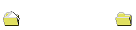

## Goodies

{: height="60" width="272"}

**Don't copy that floppy!**

Welcome to the Goodies page! This is where I keep all sorts of bits and pieces that don't quite fit anywhere else. There's a mix of old favourites, restored pages and experiments I've tinkered with over the years.

✅ Ready to Visit

**🎹 [BleepGarden Music Maker 2000](/homepages/op-1/)** 
A browser-based music maker originally created for SuperNick. Make some noise with synthesizers, keyboards, rhythms and songs. Bleep, bloop, bleep!

**☎️ [Dial-Up Networking](/homepages/modem/)** 
Hear the old-school modem connection, then dial into either a randomly selected McRetro article or one of the restored historical homepages.

**🐐 [GOATPAD 1337](/homepages/goatpad/)** 
A 64-pad browser soundboard and sequencer from 2024, with drums, effects, bass, GOAT SOUL, and melodies. A strange little musical time capsule!

**🎵 [Lunchbeat](/homepages/lunchbeat/)** 
An original 1-bit groovebox running in your web browser, with an electronics project behind it. Sometimes the simplest sounds are the most entertaining!

**🎳 [Nix's Cyber Lanes](/homepages/bowling/)** 
An old-school bowling league homepage with scores, averages and a leaderboard. Check out those lanes!

**🎮 [VRAMpage MD](/homepages/vrampage-md/)** 
Bend the bits of a Sega Mega Drive right in your browser! Load your own game ROM, experiment with video memory, work RAM and sound, and see how wonderfully strange things can get.

🗃️ Restored Historical Homepages

The original HTML and artwork from these restored sites have made it back onto McRetro.net. No modern makeover here; these are the old-style pages as they were, with just the paths fixed where necessary.

**🐟 [Fish Tank World](/homepages/fishtankworld/)** 
The original aquarium homepage, with fish biographies, tank readings, animated artwork, and a restored [photo gallery](/homepages/fishtankworld/gallery/). Splash!

**🐍 [Frank the Snake](/homepages/frank/)** 
Frank's own homepage, snake facts and an original [photo gallery](/homepages/frank/gallery.html). A big snake with a big heart!

**🐶 [Pepper the Dog Blog](/homepages/pepper/)** 
Hello, I am Pepper the Dog! The original sausage dog homepage, complete with photographs, adventures and entries dating from 2016 to 2018. Woof!

**🦔 [Sonic the Hedgehog Homepage](/homepages/sonic/)** 
One of my earliest websites, dedicated to the Sonic the Hedgehog Saturday morning cartoon. Character biographies, original images, MIDI files and even a downloadable theme song. The guestbook link is a historical placeholder, and modern browsers may block automatic music playback.

**🪐 [Space / Planets Webpage](/homepages/space/)** 
Travel back to 1996 with a page full of planets, animated graphics and some wonderfully brief astronomical descriptions.

**🌳 [Super Nature World](/homepages/nature/)** 
An old-fashioned nature homepage featuring a frog, a lizard and a few original placeholder pictures. Apparently not a place for fish or birds!

🚧 Still Under Construction

- **[GeoCities](/homepages/geocities/)**: Still needs its proper historical content restored.
- **File Server**: Not ready yet. The promised 10 KB/s downloads remain a dream!
- **Photo Gallery**: The gallery is still being restored.

As for the other tools and experiments, they'll turn up here as they become ready.

