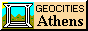
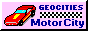
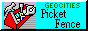
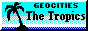
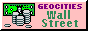

<link rel="stylesheet" href="/homepages/geocities/geocities.css">

[← GeoCities Rebuild](/homepages/geocities/) · [Neighbourhoods](/homepages/geocities/neighborhoods/) · [Project News](/homepages/geocities/news/) · [Cool Pages](/homepages/geocities/cool/)

# Original GeoCities Artwork Gallery

This is a collection of the original GIF artwork retained from my GeoCities rebuild frontend. The buttons and graphics are presented as they were saved, without replacing them with modern images. The neighbourhood buttons link to the **public directory**, not to the private archive of personal homepages.

## Frontend Graphics

The original masthead, welcome image, news banner, directory graphic, Cool Pages image, and animated GeoCities badge are all part of the restored frontend.

  <figure class="gc-artwork-tile"><figcaption>Original GeoCities Masthead</figcaption></figure>
  <figure class="gc-artwork-tile"><figcaption>Welcome Graphic</figcaption></figure>
  <figure class="gc-artwork-tile"><figcaption>Neighbourhood Directory Banner</figcaption></figure>
  <figure class="gc-artwork-tile"><figcaption>Project News Banner</figcaption></figure>
  <figure class="gc-artwork-tile"><figcaption>Cool Pages Graphic</figcaption></figure>
  <figure class="gc-artwork-tile"><figcaption>Animated GeoCities Badge</figcaption></figure>

## Neighbourhood Buttons

These are the **41 original 88×31 neighbourhood buttons** preserved in the public frontend. Select one to jump to its section in the directory.

  <a class="gc-artwork-tile" href="/homepages/geocities/neighborhoods/#Area51">Area51</a>
  <a class="gc-artwork-tile" href="/homepages/geocities/neighborhoods/#Athens">Athens</a>
  <a class="gc-artwork-tile" href="/homepages/geocities/neighborhoods/#Augusta">Augusta</a>
  <a class="gc-artwork-tile" href="/homepages/geocities/neighborhoods/#Baja">Baja</a>
  <a class="gc-artwork-tile" href="/homepages/geocities/neighborhoods/#BourbonStreet">BourbonStreet</a>
  <a class="gc-artwork-tile" href="/homepages/geocities/neighborhoods/#Broadway">Broadway</a>
  <a class="gc-artwork-tile" href="/homepages/geocities/neighborhoods/#CapeCanaveral">CapeCanaveral</a>
  <a class="gc-artwork-tile" href="/homepages/geocities/neighborhoods/#CapitolHill">CapitolHill</a>
  <a class="gc-artwork-tile" href="/homepages/geocities/neighborhoods/#CollegePark">CollegePark</a>
  <a class="gc-artwork-tile" href="/homepages/geocities/neighborhoods/#Colosseum">Colosseum</a>
  <a class="gc-artwork-tile" href="/homepages/geocities/neighborhoods/#EnchantedForest">EnchantedForest</a>
  <a class="gc-artwork-tile" href="/homepages/geocities/neighborhoods/#Eureka">Eureka</a>
  <a class="gc-artwork-tile" href="/homepages/geocities/neighborhoods/#FashionAvenue">FashionAvenue</a>
  <a class="gc-artwork-tile" href="/homepages/geocities/neighborhoods/#Heartland">Heartland</a>
  <a class="gc-artwork-tile" href="/homepages/geocities/neighborhoods/#Hollywood">Hollywood</a>
  <a class="gc-artwork-tile" href="/homepages/geocities/neighborhoods/#HotSprings">HotSprings</a>
  <a class="gc-artwork-tile" href="/homepages/geocities/neighborhoods/#MadisonAvenue">MadisonAvenue</a>
  <a class="gc-artwork-tile" href="/homepages/geocities/neighborhoods/#MotorCity">MotorCity</a>
  <a class="gc-artwork-tile" href="/homepages/geocities/neighborhoods/#NapaValley">NapaValley</a>
  <a class="gc-artwork-tile" href="/homepages/geocities/neighborhoods/#Nashville">Nashville</a>
  <a class="gc-artwork-tile" href="/homepages/geocities/neighborhoods/#Paris">Paris</a>
  <a class="gc-artwork-tile" href="/homepages/geocities/neighborhoods/#Pentagon">Pentagon</a>
  <a class="gc-artwork-tile" href="/homepages/geocities/neighborhoods/#Petsburgh">Petsburgh</a>
  <a class="gc-artwork-tile" href="/homepages/geocities/neighborhoods/#PicketFence">PicketFence</a>
  <a class="gc-artwork-tile" href="/homepages/geocities/neighborhoods/#Pipeline">Pipeline</a>
  <a class="gc-artwork-tile" href="/homepages/geocities/neighborhoods/#RainForest">RainForest</a>
  <a class="gc-artwork-tile" href="/homepages/geocities/neighborhoods/#ResearchTriangle">ResearchTriangle</a>
  <a class="gc-artwork-tile" href="/homepages/geocities/neighborhoods/#RodeoDrive">RodeoDrive</a>
  <a class="gc-artwork-tile" href="/homepages/geocities/neighborhoods/#SiliconValley">SiliconValley</a>
  <a class="gc-artwork-tile" href="/homepages/geocities/neighborhoods/#SoHo">SoHo</a>
  <a class="gc-artwork-tile" href="/homepages/geocities/neighborhoods/#SouthBeach">SouthBeach</a>
  <a class="gc-artwork-tile" href="/homepages/geocities/neighborhoods/#SunsetStrip">SunsetStrip</a>
  <a class="gc-artwork-tile" href="/homepages/geocities/neighborhoods/#TelevisionCity">TelevisionCity</a>
  <a class="gc-artwork-tile" href="/homepages/geocities/neighborhoods/#TheTropics">TheTropics</a>
  <a class="gc-artwork-tile" href="/homepages/geocities/neighborhoods/#TimesSquare">TimesSquare</a>
  <a class="gc-artwork-tile" href="/homepages/geocities/neighborhoods/#Tokyo">Tokyo</a>
  <a class="gc-artwork-tile" href="/homepages/geocities/neighborhoods/#Vienna">Vienna</a>
  <a class="gc-artwork-tile" href="/homepages/geocities/neighborhoods/#WallStreet">WallStreet</a>
  <a class="gc-artwork-tile" href="/homepages/geocities/neighborhoods/#Wellesley">Wellesley</a>
  <a class="gc-artwork-tile" href="/homepages/geocities/neighborhoods/#WestHollywood">WestHollywood</a>
  <a class="gc-artwork-tile" href="/homepages/geocities/neighborhoods/#Yosemite">Yosemite</a>

## Preserved Neighbourhood Banners

Two additional neighbourhood banners are present in this public copy of the rebuild's artwork. The other neighbourhoods still have their buttons and historical directory entries, but I haven't added any missing banner files.

  <a class="gc-artwork-tile" href="/homepages/geocities/neighborhoods/#Area51">Area51</a>
  <a class="gc-artwork-tile" href="/homepages/geocities/neighborhoods/#TimesSquare">TimesSquare</a>

The full archive of other people's historical homepages remains private. These are only the graphics already included with my public restoration.

[Return to the GeoCities project page](/homepages/geocities/)
