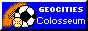
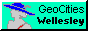

<link rel="stylesheet" href="/homepages/geocities/geocities.css">



# Original GeoCities Artwork Gallery

This is a collection of the original GIF artwork retained from my GeoCities rebuild frontend. The buttons and graphics are presented as they were saved, without replacing them with modern images. The neighbourhood buttons link to the **public directory**, not to the private archive of personal homepages.

<nav class="gc-artwork-jump" aria-label="Jump to artwork category">
  <a href="#frontend-graphics">Frontend Graphics</a>
  <a href="#neighbourhood-buttons">Neighbourhood Buttons</a>
  <a href="#preserved-banners">Preserved Banners</a>
</nav>

<h2 id="frontend-graphics">Frontend Graphics</h2>

The original masthead, welcome image, news banner, directory graphic, Cool Pages image, and animated GeoCities badge are all part of the restored frontend.

  <figure class="gc-artwork-tile"><figcaption>Original GeoCities Masthead</figcaption></figure>
  <figure class="gc-artwork-tile"><figcaption>Welcome Graphic</figcaption></figure>
  <figure class="gc-artwork-tile"><figcaption>Neighbourhood Directory Banner</figcaption></figure>
  <figure class="gc-artwork-tile"><figcaption>Project News Banner</figcaption></figure>
  <figure class="gc-artwork-tile"><figcaption>Cool Pages Graphic</figcaption></figure>
  <figure class="gc-artwork-tile"><figcaption>Animated GeoCities Badge</figcaption></figure>

<h2 id="neighbourhood-buttons">Neighbourhood Buttons</h2>

These are the **41 original 88×31 neighbourhood buttons** preserved in the public frontend. Select a GIF to view the original image at full size, or choose its Explore link to open the public neighbourhood directory.

  
<a class="gc-artwork-directory-link" href="/homepages/geocities/neighborhoods/#Area51">Explore Area51</a>

  
<a class="gc-artwork-directory-link" href="/homepages/geocities/neighborhoods/#Athens">Explore Athens</a>

  
<a class="gc-artwork-directory-link" href="/homepages/geocities/neighborhoods/#Augusta">Explore Augusta</a>

  
<a class="gc-artwork-directory-link" href="/homepages/geocities/neighborhoods/#Baja">Explore Baja</a>

  
<a class="gc-artwork-directory-link" href="/homepages/geocities/neighborhoods/#BourbonStreet">Explore BourbonStreet</a>

  
<a class="gc-artwork-directory-link" href="/homepages/geocities/neighborhoods/#Broadway">Explore Broadway</a>

  
<a class="gc-artwork-directory-link" href="/homepages/geocities/neighborhoods/#CapeCanaveral">Explore CapeCanaveral</a>

  
<a class="gc-artwork-directory-link" href="/homepages/geocities/neighborhoods/#CapitolHill">Explore CapitolHill</a>

  
<a class="gc-artwork-directory-link" href="/homepages/geocities/neighborhoods/#CollegePark">Explore CollegePark</a>

  
<a class="gc-artwork-directory-link" href="/homepages/geocities/neighborhoods/#Colosseum">Explore Colosseum</a>

  
<a class="gc-artwork-directory-link" href="/homepages/geocities/neighborhoods/#EnchantedForest">Explore EnchantedForest</a>

  
<a class="gc-artwork-directory-link" href="/homepages/geocities/neighborhoods/#Eureka">Explore Eureka</a>

  
<a class="gc-artwork-directory-link" href="/homepages/geocities/neighborhoods/#FashionAvenue">Explore FashionAvenue</a>

  
<a class="gc-artwork-directory-link" href="/homepages/geocities/neighborhoods/#Heartland">Explore Heartland</a>

  
<a class="gc-artwork-directory-link" href="/homepages/geocities/neighborhoods/#Hollywood">Explore Hollywood</a>

  
<a class="gc-artwork-directory-link" href="/homepages/geocities/neighborhoods/#HotSprings">Explore HotSprings</a>

  
<a class="gc-artwork-directory-link" href="/homepages/geocities/neighborhoods/#MadisonAvenue">Explore MadisonAvenue</a>

  
<a class="gc-artwork-directory-link" href="/homepages/geocities/neighborhoods/#MotorCity">Explore MotorCity</a>

  
<a class="gc-artwork-directory-link" href="/homepages/geocities/neighborhoods/#NapaValley">Explore NapaValley</a>

  
<a class="gc-artwork-directory-link" href="/homepages/geocities/neighborhoods/#Nashville">Explore Nashville</a>

  
<a class="gc-artwork-directory-link" href="/homepages/geocities/neighborhoods/#Paris">Explore Paris</a>

  
<a class="gc-artwork-directory-link" href="/homepages/geocities/neighborhoods/#Pentagon">Explore Pentagon</a>

  
<a class="gc-artwork-directory-link" href="/homepages/geocities/neighborhoods/#Petsburgh">Explore Petsburgh</a>

  
<a class="gc-artwork-directory-link" href="/homepages/geocities/neighborhoods/#PicketFence">Explore PicketFence</a>

  
<a class="gc-artwork-directory-link" href="/homepages/geocities/neighborhoods/#Pipeline">Explore Pipeline</a>

  
<a class="gc-artwork-directory-link" href="/homepages/geocities/neighborhoods/#RainForest">Explore RainForest</a>

  
<a class="gc-artwork-directory-link" href="/homepages/geocities/neighborhoods/#ResearchTriangle">Explore ResearchTriangle</a>

  
<a class="gc-artwork-directory-link" href="/homepages/geocities/neighborhoods/#RodeoDrive">Explore RodeoDrive</a>

  
<a class="gc-artwork-directory-link" href="/homepages/geocities/neighborhoods/#SiliconValley">Explore SiliconValley</a>

  
<a class="gc-artwork-directory-link" href="/homepages/geocities/neighborhoods/#SoHo">Explore SoHo</a>

  
<a class="gc-artwork-directory-link" href="/homepages/geocities/neighborhoods/#SouthBeach">Explore SouthBeach</a>

  
<a class="gc-artwork-directory-link" href="/homepages/geocities/neighborhoods/#SunsetStrip">Explore SunsetStrip</a>

  
<a class="gc-artwork-directory-link" href="/homepages/geocities/neighborhoods/#TelevisionCity">Explore TelevisionCity</a>

  
<a class="gc-artwork-directory-link" href="/homepages/geocities/neighborhoods/#TheTropics">Explore TheTropics</a>

  
<a class="gc-artwork-directory-link" href="/homepages/geocities/neighborhoods/#TimesSquare">Explore TimesSquare</a>

  
<a class="gc-artwork-directory-link" href="/homepages/geocities/neighborhoods/#Tokyo">Explore Tokyo</a>

  
<a class="gc-artwork-directory-link" href="/homepages/geocities/neighborhoods/#Vienna">Explore Vienna</a>

  
<a class="gc-artwork-directory-link" href="/homepages/geocities/neighborhoods/#WallStreet">Explore WallStreet</a>

  
<a class="gc-artwork-directory-link" href="/homepages/geocities/neighborhoods/#Wellesley">Explore Wellesley</a>

  
<a class="gc-artwork-directory-link" href="/homepages/geocities/neighborhoods/#WestHollywood">Explore WestHollywood</a>

  
<a class="gc-artwork-directory-link" href="/homepages/geocities/neighborhoods/#Yosemite">Explore Yosemite</a>

<h2 id="preserved-banners">Preserved Neighbourhood Banners</h2>

Two additional neighbourhood banners are present in this public copy of the rebuild's artwork. The other neighbourhoods still have their buttons and historical directory entries, but I haven't added any missing banner files.

  
<a class="gc-artwork-directory-link" href="/homepages/geocities/neighborhoods/#Area51">Explore Area51</a>

  
<a class="gc-artwork-directory-link" href="/homepages/geocities/neighborhoods/#TimesSquare">Explore TimesSquare</a>

The full archive of other people's historical homepages remains private. These are only the graphics already included with my public restoration.

<a href="#gc-artwork-top">↑ Back to Top</a>

[Return to the GeoCities project page](/homepages/geocities/)
