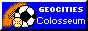
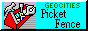
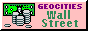
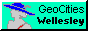

<link rel="stylesheet" href="/homepages/geocities/geocities.css">



# Visit the GeoCities Neighbourhoods

GeoCities members, known as Homesteaders, built homepages in themed neighbourhoods. I restored **all 41 neighbourhoods** from my original rebuild frontend, including their vintage buttons, descriptions, and listed suburbs. The historic total of **298,559 Homesteaders** comes from that reconstruction, **not current measurements** of available websites. Some original sites were never preserved.

**The directory and artwork are public.** The neighbourhood and suburb links lead to my personal archive, which isn't accessible outside my network.

  <strong>41</strong> neighbourhoods
  <strong>714</strong> suburbs
  <strong>298,559</strong> historical Homesteaders

  <label for="gc-neighbourhood-search">Find a Neighbourhood or Suburb</label>
  

    <input id="gc-neighbourhood-search" type="search" autocomplete="off" placeholder="Try Area51, Alien, Tokyo..." aria-controls="gc-neighbourhood-list" aria-describedby="gc-neighbourhood-hint">
  

  

    <button type="button" data-gc-action="expand">Expand All</button>
    <button type="button" data-gc-action="collapse">Collapse All</button>
    <button type="button" data-gc-action="random" aria-label="Random Neighbourhood">🎲 Random</button>
    <button type="button" data-gc-action="reset">Reset View</button>
  

  

    <label class="gc-sort-label" for="gc-neighbourhood-sort">Sort Neighbourhoods
      <select id="gc-neighbourhood-sort">
        <option value="alphabetical">Alphabetical (Original)</option>
        <option value="largest">Largest Population First</option>
        <option value="smallest">Smallest Population First</option>
        <option value="most-suburbs">Most Suburbs First</option>
        <option value="fewest-suburbs">Fewest Suburbs First</option>
      </select>
    </label>
    <label class="gc-suburb-only-label" for="gc-suburbs-matching-only">
      <input id="gc-suburbs-matching-only" type="checkbox" disabled> Only Matching Suburbs
    </label>
  

  

    <output id="gc-neighbourhood-results" aria-live="polite" aria-atomic="true">Showing all 41 neighbourhoods.</output>
    

      <button type="button" data-gc-action="copy-search" disabled>Copy Search Link</button>
      
    

  

  
Press / to search, Esc to clear. Searches update the URL.

  
No neighbourhoods or suburbs match your search. Try another term, or clear your search.

  <button type="button" data-gc-action="clear-search">Clear Search</button>

<section class="gc-neighbourhood" id="Area51">

Area51<small>Historic population: 17,729</small><small>Listed suburbs: 43</small>

Science fiction and fantasy.

<a href="http://geocities.mcretro.net/Area51/" target="_blank" rel="noopener noreferrer nofollow">Open Area51 in the archive</a>

<a href="http://geocities.mcretro.net/Area51/Alien/" target="_blank" rel="noopener noreferrer nofollow">Alien</a>
<a href="http://geocities.mcretro.net/Area51/Atlantis/" target="_blank" rel="noopener noreferrer nofollow">Atlantis</a>
<a href="http://geocities.mcretro.net/Area51/Aurora/" target="_blank" rel="noopener noreferrer nofollow">Aurora</a>
<a href="http://geocities.mcretro.net/Area51/Capsule/" target="_blank" rel="noopener noreferrer nofollow">Capsule</a>
<a href="http://geocities.mcretro.net/Area51/Cavern/" target="_blank" rel="noopener noreferrer nofollow">Cavern</a>
<a href="http://geocities.mcretro.net/Area51/Chamber/" target="_blank" rel="noopener noreferrer nofollow">Chamber</a>
<a href="http://geocities.mcretro.net/Area51/Comet/" target="_blank" rel="noopener noreferrer nofollow">Comet</a>
<a href="http://geocities.mcretro.net/Area51/Corridor/" target="_blank" rel="noopener noreferrer nofollow">Corridor</a>
<a href="http://geocities.mcretro.net/Area51/Crater/" target="_blank" rel="noopener noreferrer nofollow">Crater</a>
<a href="http://geocities.mcretro.net/Area51/Dimension/" target="_blank" rel="noopener noreferrer nofollow">Dimension</a>
<a href="http://geocities.mcretro.net/Area51/Dreamworld/" target="_blank" rel="noopener noreferrer nofollow">Dreamworld</a>
<a href="http://geocities.mcretro.net/Area51/Dunes/" target="_blank" rel="noopener noreferrer nofollow">Dunes</a>
<a href="http://geocities.mcretro.net/Area51/Dungeon/" target="_blank" rel="noopener noreferrer nofollow">Dungeon</a>
<a href="http://geocities.mcretro.net/Area51/Hole/" target="_blank" rel="noopener noreferrer nofollow">Hole</a>
<a href="http://geocities.mcretro.net/Area51/Hollow/" target="_blank" rel="noopener noreferrer nofollow">Hollow</a>
<a href="http://geocities.mcretro.net/Area51/Jupiter/" target="_blank" rel="noopener noreferrer nofollow">Jupiter</a>
<a href="http://geocities.mcretro.net/Area51/Keep/" target="_blank" rel="noopener noreferrer nofollow">Keep</a>
<a href="http://geocities.mcretro.net/Area51/Labyrinth/" target="_blank" rel="noopener noreferrer nofollow">Labyrinth</a>
<a href="http://geocities.mcretro.net/Area51/Lair/" target="_blank" rel="noopener noreferrer nofollow">Lair</a>
<a href="http://geocities.mcretro.net/Area51/Matrix/" target="_blank" rel="noopener noreferrer nofollow">Matrix</a>
<a href="http://geocities.mcretro.net/Area51/Meteor/" target="_blank" rel="noopener noreferrer nofollow">Meteor</a>
<a href="http://geocities.mcretro.net/Area51/Nebula/" target="_blank" rel="noopener noreferrer nofollow">Nebula</a>
<a href="http://geocities.mcretro.net/Area51/Neptune/" target="_blank" rel="noopener noreferrer nofollow">Neptune</a>
<a href="http://geocities.mcretro.net/Area51/Nova/" target="_blank" rel="noopener noreferrer nofollow">Nova</a>
<a href="http://geocities.mcretro.net/Area51/Omega/" target="_blank" rel="noopener noreferrer nofollow">Omega</a>
<a href="http://geocities.mcretro.net/Area51/Orion/" target="_blank" rel="noopener noreferrer nofollow">Orion</a>
<a href="http://geocities.mcretro.net/Area51/Planet/" target="_blank" rel="noopener noreferrer nofollow">Planet</a>
<a href="http://geocities.mcretro.net/Area51/Portal/" target="_blank" rel="noopener noreferrer nofollow">Portal</a>
<a href="http://geocities.mcretro.net/Area51/Quadrant/" target="_blank" rel="noopener noreferrer nofollow">Quadrant</a>
<a href="http://geocities.mcretro.net/Area51/Quark/" target="_blank" rel="noopener noreferrer nofollow">Quark</a>
<a href="http://geocities.mcretro.net/Area51/Quasar/" target="_blank" rel="noopener noreferrer nofollow">Quasar</a>
<a href="http://geocities.mcretro.net/Area51/Rampart/" target="_blank" rel="noopener noreferrer nofollow">Rampart</a>
<a href="http://geocities.mcretro.net/Area51/Realm/" target="_blank" rel="noopener noreferrer nofollow">Realm</a>
<a href="http://geocities.mcretro.net/Area51/Saturn/" target="_blank" rel="noopener noreferrer nofollow">Saturn</a>
<a href="http://geocities.mcretro.net/Area51/Shadowlands/" target="_blank" rel="noopener noreferrer nofollow">Shadowlands</a>
<a href="http://geocities.mcretro.net/Area51/Shire/" target="_blank" rel="noopener noreferrer nofollow">Shire</a>
<a href="http://geocities.mcretro.net/Area51/Shuttle/" target="_blank" rel="noopener noreferrer nofollow">Shuttle</a>
<a href="http://geocities.mcretro.net/Area51/Stargate/" target="_blank" rel="noopener noreferrer nofollow">Stargate</a>
<a href="http://geocities.mcretro.net/Area51/Starship/" target="_blank" rel="noopener noreferrer nofollow">Starship</a>
<a href="http://geocities.mcretro.net/Area51/Station/" target="_blank" rel="noopener noreferrer nofollow">Station</a>
<a href="http://geocities.mcretro.net/Area51/Underworld/" target="_blank" rel="noopener noreferrer nofollow">Underworld</a>
<a href="http://geocities.mcretro.net/Area51/Vault/" target="_blank" rel="noopener noreferrer nofollow">Vault</a>
<a href="http://geocities.mcretro.net/Area51/Zone/" target="_blank" rel="noopener noreferrer nofollow">Zone</a>

</section>

<section class="gc-neighbourhood" id="Athens">

Athens<small>Historic population: 16,038</small><small>Listed suburbs: 26</small>

Education, literature, poetry, philosophy.

<a href="http://geocities.mcretro.net/Athens/" target="_blank" rel="noopener noreferrer nofollow">Open Athens in the archive</a>

<a href="http://geocities.mcretro.net/Athens/Academy/" target="_blank" rel="noopener noreferrer nofollow">Academy</a>
<a href="http://geocities.mcretro.net/Athens/Acropolis/" target="_blank" rel="noopener noreferrer nofollow">Acropolis</a>
<a href="http://geocities.mcretro.net/Athens/Aegean/" target="_blank" rel="noopener noreferrer nofollow">Aegean</a>
<a href="http://geocities.mcretro.net/Athens/Agora/" target="_blank" rel="noopener noreferrer nofollow">Agora</a>
<a href="http://geocities.mcretro.net/Athens/Atlantis/" target="_blank" rel="noopener noreferrer nofollow">Atlantis</a>
<a href="http://geocities.mcretro.net/Athens/Atrium/" target="_blank" rel="noopener noreferrer nofollow">Atrium</a>
<a href="http://geocities.mcretro.net/Athens/Bridge/" target="_blank" rel="noopener noreferrer nofollow">Bridge</a>
<a href="http://geocities.mcretro.net/Athens/Column/" target="_blank" rel="noopener noreferrer nofollow">Column</a>
<a href="http://geocities.mcretro.net/Athens/Crete/" target="_blank" rel="noopener noreferrer nofollow">Crete</a>
<a href="http://geocities.mcretro.net/Athens/Cyprus/" target="_blank" rel="noopener noreferrer nofollow">Cyprus</a>
<a href="http://geocities.mcretro.net/Athens/Delphi/" target="_blank" rel="noopener noreferrer nofollow">Delphi</a>
<a href="http://geocities.mcretro.net/Athens/Forum/" target="_blank" rel="noopener noreferrer nofollow">Forum</a>
<a href="http://geocities.mcretro.net/Athens/Ithaca/" target="_blank" rel="noopener noreferrer nofollow">Ithaca</a>
<a href="http://geocities.mcretro.net/Athens/Library/" target="_blank" rel="noopener noreferrer nofollow">Library</a>
<a href="http://geocities.mcretro.net/Athens/Marathon/" target="_blank" rel="noopener noreferrer nofollow">Marathon</a>
<a href="http://geocities.mcretro.net/Athens/Marble/" target="_blank" rel="noopener noreferrer nofollow">Marble</a>
<a href="http://geocities.mcretro.net/Athens/Olympus/" target="_blank" rel="noopener noreferrer nofollow">Olympus</a>
<a href="http://geocities.mcretro.net/Athens/Oracle/" target="_blank" rel="noopener noreferrer nofollow">Oracle</a>
<a href="http://geocities.mcretro.net/Athens/Pantheon/" target="_blank" rel="noopener noreferrer nofollow">Pantheon</a>
<a href="http://geocities.mcretro.net/Athens/Parthenon/" target="_blank" rel="noopener noreferrer nofollow">Parthenon</a>
<a href="http://geocities.mcretro.net/Athens/Rhodes/" target="_blank" rel="noopener noreferrer nofollow">Rhodes</a>
<a href="http://geocities.mcretro.net/Athens/Sparta/" target="_blank" rel="noopener noreferrer nofollow">Sparta</a>
<a href="http://geocities.mcretro.net/Athens/Stage/" target="_blank" rel="noopener noreferrer nofollow">Stage</a>
<a href="http://geocities.mcretro.net/Athens/Styx/" target="_blank" rel="noopener noreferrer nofollow">Styx</a>
<a href="http://geocities.mcretro.net/Athens/Thebes/" target="_blank" rel="noopener noreferrer nofollow">Thebes</a>
<a href="http://geocities.mcretro.net/Athens/Troy/" target="_blank" rel="noopener noreferrer nofollow">Troy</a>

</section>

<section class="gc-neighbourhood" id="Augusta">

Augusta<small>Historic population: 1,416</small><small>Listed suburbs: 3</small>

Golf and the finer side of the fairways.

<a href="http://geocities.mcretro.net/Augusta/" target="_blank" rel="noopener noreferrer nofollow">Open Augusta in the archive</a>

<a href="http://geocities.mcretro.net/Augusta/Fairway/" target="_blank" rel="noopener noreferrer nofollow">Fairway</a>
<a href="http://geocities.mcretro.net/Augusta/Green/" target="_blank" rel="noopener noreferrer nofollow">Green</a>
<a href="http://geocities.mcretro.net/Augusta/Links/" target="_blank" rel="noopener noreferrer nofollow">Links</a>

</section>

<section class="gc-neighbourhood" id="Baja">

Baja<small>Historic population: 3,295</small><small>Listed suburbs: 9</small>

Four-wheeling, SUVs, off-roading, adventure travel.

<a href="http://geocities.mcretro.net/Baja/" target="_blank" rel="noopener noreferrer nofollow">Open Baja in the archive</a>

<a href="http://geocities.mcretro.net/Baja/Canyon/" target="_blank" rel="noopener noreferrer nofollow">Canyon</a>
<a href="http://geocities.mcretro.net/Baja/Cliffs/" target="_blank" rel="noopener noreferrer nofollow">Cliffs</a>
<a href="http://geocities.mcretro.net/Baja/Desert/" target="_blank" rel="noopener noreferrer nofollow">Desert</a>
<a href="http://geocities.mcretro.net/Baja/Dunes/" target="_blank" rel="noopener noreferrer nofollow">Dunes</a>
<a href="http://geocities.mcretro.net/Baja/Mesa/" target="_blank" rel="noopener noreferrer nofollow">Mesa</a>
<a href="http://geocities.mcretro.net/Baja/Mountain/" target="_blank" rel="noopener noreferrer nofollow">Mountain</a>
<a href="http://geocities.mcretro.net/Baja/Outback/" target="_blank" rel="noopener noreferrer nofollow">Outback</a>
<a href="http://geocities.mcretro.net/Baja/Ravine/" target="_blank" rel="noopener noreferrer nofollow">Ravine</a>
<a href="http://geocities.mcretro.net/Baja/Trails/" target="_blank" rel="noopener noreferrer nofollow">Trails</a>

</section>

<section class="gc-neighbourhood" id="BourbonStreet">

BourbonStreet<small>Historic population: 662</small><small>Listed suburbs: 6</small>

Jazz, Cajun food, Southern culture.

<a href="http://geocities.mcretro.net/BourbonStreet/" target="_blank" rel="noopener noreferrer nofollow">Open BourbonStreet in the archive</a>

<a href="http://geocities.mcretro.net/BourbonStreet/Bayou/" target="_blank" rel="noopener noreferrer nofollow">Bayou</a>
<a href="http://geocities.mcretro.net/BourbonStreet/Canal/" target="_blank" rel="noopener noreferrer nofollow">Canal</a>
<a href="http://geocities.mcretro.net/BourbonStreet/Delta/" target="_blank" rel="noopener noreferrer nofollow">Delta</a>
<a href="http://geocities.mcretro.net/BourbonStreet/Inn/" target="_blank" rel="noopener noreferrer nofollow">Inn</a>
<a href="http://geocities.mcretro.net/BourbonStreet/Quarter/" target="_blank" rel="noopener noreferrer nofollow">Quarter</a>
<a href="http://geocities.mcretro.net/BourbonStreet/Square/" target="_blank" rel="noopener noreferrer nofollow">Square</a>

</section>

<section class="gc-neighbourhood" id="Broadway">

Broadway<small>Historic population: 0</small><small>Listed suburbs: 7</small>

Theater, musicals, show business.

<strong>Note:</strong> This neighbourhood was recorded as absent from the restored archive.

<a href="http://geocities.mcretro.net/Broadway/" target="_blank" rel="noopener noreferrer nofollow">Open Broadway in the archive</a>

<a href="http://geocities.mcretro.net/Broadway/Alley/" target="_blank" rel="noopener noreferrer nofollow">Alley</a>
<a href="http://geocities.mcretro.net/Broadway/Balcony/" target="_blank" rel="noopener noreferrer nofollow">Balcony</a>
<a href="http://geocities.mcretro.net/Broadway/Booth/" target="_blank" rel="noopener noreferrer nofollow">Booth</a>
<a href="http://geocities.mcretro.net/Broadway/Lobby/" target="_blank" rel="noopener noreferrer nofollow">Lobby</a>
<a href="http://geocities.mcretro.net/Broadway/Orchestra/" target="_blank" rel="noopener noreferrer nofollow">Orchestra</a>
<a href="http://geocities.mcretro.net/Broadway/Stage/" target="_blank" rel="noopener noreferrer nofollow">Stage</a>
<a href="http://geocities.mcretro.net/Broadway/Wing/" target="_blank" rel="noopener noreferrer nofollow">Wing</a>

</section>

<section class="gc-neighbourhood" id="CapeCanaveral">

CapeCanaveral<small>Historic population: 6,329</small><small>Listed suburbs: 11</small>

Science, mathematics, aviation.

<a href="http://geocities.mcretro.net/CapeCanaveral/" target="_blank" rel="noopener noreferrer nofollow">Open CapeCanaveral in the archive</a>

<a href="http://geocities.mcretro.net/CapeCanaveral/Campus/" target="_blank" rel="noopener noreferrer nofollow">Campus</a>
<a href="http://geocities.mcretro.net/CapeCanaveral/Cockpit/" target="_blank" rel="noopener noreferrer nofollow">Cockpit</a>
<a href="http://geocities.mcretro.net/CapeCanaveral/Galaxy/" target="_blank" rel="noopener noreferrer nofollow">Galaxy</a>
<a href="http://geocities.mcretro.net/CapeCanaveral/Hall/" target="_blank" rel="noopener noreferrer nofollow">Hall</a>
<a href="http://geocities.mcretro.net/CapeCanaveral/Hangar/" target="_blank" rel="noopener noreferrer nofollow">Hangar</a>
<a href="http://geocities.mcretro.net/CapeCanaveral/Lab/" target="_blank" rel="noopener noreferrer nofollow">Lab</a>
<a href="http://geocities.mcretro.net/CapeCanaveral/Launchpad/" target="_blank" rel="noopener noreferrer nofollow">Launchpad</a>
<a href="http://geocities.mcretro.net/CapeCanaveral/Orbit/" target="_blank" rel="noopener noreferrer nofollow">Orbit</a>
<a href="http://geocities.mcretro.net/CapeCanaveral/Runway/" target="_blank" rel="noopener noreferrer nofollow">Runway</a>
<a href="http://geocities.mcretro.net/CapeCanaveral/Shuttle/" target="_blank" rel="noopener noreferrer nofollow">Shuttle</a>
<a href="http://geocities.mcretro.net/CapeCanaveral/Station/" target="_blank" rel="noopener noreferrer nofollow">Station</a>

</section>

<section class="gc-neighbourhood" id="CapitolHill">

CapitolHill<small>Historic population: 4,198</small><small>Listed suburbs: 6</small>

Government, politics, and lots of strong opinions.

<a href="http://geocities.mcretro.net/CapitolHill/" target="_blank" rel="noopener noreferrer nofollow">Open CapitolHill in the archive</a>

<a href="http://geocities.mcretro.net/CapitolHill/Congress/" target="_blank" rel="noopener noreferrer nofollow">Congress</a>
<a href="http://geocities.mcretro.net/CapitolHill/Embassy/" target="_blank" rel="noopener noreferrer nofollow">Embassy</a>
<a href="http://geocities.mcretro.net/CapitolHill/Lobby/" target="_blank" rel="noopener noreferrer nofollow">Lobby</a>
<a href="http://geocities.mcretro.net/CapitolHill/Parliament/" target="_blank" rel="noopener noreferrer nofollow">Parliament</a>
<a href="http://geocities.mcretro.net/CapitolHill/Rotunda/" target="_blank" rel="noopener noreferrer nofollow">Rotunda</a>
<a href="http://geocities.mcretro.net/CapitolHill/Senate/" target="_blank" rel="noopener noreferrer nofollow">Senate</a>

</section>

<section class="gc-neighbourhood" id="CollegePark">

CollegePark<small>Historic population: 10,149</small><small>Listed suburbs: 24</small>

University life, from academics to extracurriculars.

<a href="http://geocities.mcretro.net/CollegePark/" target="_blank" rel="noopener noreferrer nofollow">Open CollegePark in the archive</a>

<a href="http://geocities.mcretro.net/CollegePark/Bookstore/" target="_blank" rel="noopener noreferrer nofollow">Bookstore</a>
<a href="http://geocities.mcretro.net/CollegePark/Campus/" target="_blank" rel="noopener noreferrer nofollow">Campus</a>
<a href="http://geocities.mcretro.net/CollegePark/Center/" target="_blank" rel="noopener noreferrer nofollow">Center</a>
<a href="http://geocities.mcretro.net/CollegePark/Classroom/" target="_blank" rel="noopener noreferrer nofollow">Classroom</a>
<a href="http://geocities.mcretro.net/CollegePark/Club/" target="_blank" rel="noopener noreferrer nofollow">Club</a>
<a href="http://geocities.mcretro.net/CollegePark/Den/" target="_blank" rel="noopener noreferrer nofollow">Den</a>
<a href="http://geocities.mcretro.net/CollegePark/Dorm/" target="_blank" rel="noopener noreferrer nofollow">Dorm</a>
<a href="http://geocities.mcretro.net/CollegePark/Field/" target="_blank" rel="noopener noreferrer nofollow">Field</a>
<a href="http://geocities.mcretro.net/CollegePark/Grounds/" target="_blank" rel="noopener noreferrer nofollow">Grounds</a>
<a href="http://geocities.mcretro.net/CollegePark/Gym/" target="_blank" rel="noopener noreferrer nofollow">Gym</a>
<a href="http://geocities.mcretro.net/CollegePark/Hall/" target="_blank" rel="noopener noreferrer nofollow">Hall</a>
<a href="http://geocities.mcretro.net/CollegePark/Housing/" target="_blank" rel="noopener noreferrer nofollow">Housing</a>
<a href="http://geocities.mcretro.net/CollegePark/Lab/" target="_blank" rel="noopener noreferrer nofollow">Lab</a>
<a href="http://geocities.mcretro.net/CollegePark/Library/" target="_blank" rel="noopener noreferrer nofollow">Library</a>
<a href="http://geocities.mcretro.net/CollegePark/Locker/" target="_blank" rel="noopener noreferrer nofollow">Locker</a>
<a href="http://geocities.mcretro.net/CollegePark/Lounge/" target="_blank" rel="noopener noreferrer nofollow">Lounge</a>
<a href="http://geocities.mcretro.net/CollegePark/Plaza/" target="_blank" rel="noopener noreferrer nofollow">Plaza</a>
<a href="http://geocities.mcretro.net/CollegePark/Pool/" target="_blank" rel="noopener noreferrer nofollow">Pool</a>
<a href="http://geocities.mcretro.net/CollegePark/Quad/" target="_blank" rel="noopener noreferrer nofollow">Quad</a>
<a href="http://geocities.mcretro.net/CollegePark/Residence/" target="_blank" rel="noopener noreferrer nofollow">Residence</a>
<a href="http://geocities.mcretro.net/CollegePark/Square/" target="_blank" rel="noopener noreferrer nofollow">Square</a>
<a href="http://geocities.mcretro.net/CollegePark/Stadium/" target="_blank" rel="noopener noreferrer nofollow">Stadium</a>
<a href="http://geocities.mcretro.net/CollegePark/Theater/" target="_blank" rel="noopener noreferrer nofollow">Theater</a>
<a href="http://geocities.mcretro.net/CollegePark/Union/" target="_blank" rel="noopener noreferrer nofollow">Union</a>

</section>

<section class="gc-neighbourhood" id="Colosseum">

Colosseum<small>Historic population: 13,294</small><small>Listed suburbs: 28</small>

Sports and recreation.

<a href="http://geocities.mcretro.net/Colosseum/" target="_blank" rel="noopener noreferrer nofollow">Open Colosseum in the archive</a>

<a href="http://geocities.mcretro.net/Colosseum/Arena/" target="_blank" rel="noopener noreferrer nofollow">Arena</a>
<a href="http://geocities.mcretro.net/Colosseum/Base/" target="_blank" rel="noopener noreferrer nofollow">Base</a>
<a href="http://geocities.mcretro.net/Colosseum/Bench/" target="_blank" rel="noopener noreferrer nofollow">Bench</a>
<a href="http://geocities.mcretro.net/Colosseum/Bleachers/" target="_blank" rel="noopener noreferrer nofollow">Bleachers</a>
<a href="http://geocities.mcretro.net/Colosseum/Court/" target="_blank" rel="noopener noreferrer nofollow">Court</a>
<a href="http://geocities.mcretro.net/Colosseum/Dome/" target="_blank" rel="noopener noreferrer nofollow">Dome</a>
<a href="http://geocities.mcretro.net/Colosseum/Dugout/" target="_blank" rel="noopener noreferrer nofollow">Dugout</a>
<a href="http://geocities.mcretro.net/Colosseum/Field/" target="_blank" rel="noopener noreferrer nofollow">Field</a>
<a href="http://geocities.mcretro.net/Colosseum/Goal/" target="_blank" rel="noopener noreferrer nofollow">Goal</a>
<a href="http://geocities.mcretro.net/Colosseum/Gym/" target="_blank" rel="noopener noreferrer nofollow">Gym</a>
<a href="http://geocities.mcretro.net/Colosseum/Hoop/" target="_blank" rel="noopener noreferrer nofollow">Hoop</a>
<a href="http://geocities.mcretro.net/Colosseum/Lane/" target="_blank" rel="noopener noreferrer nofollow">Lane</a>
<a href="http://geocities.mcretro.net/Colosseum/Lodge/" target="_blank" rel="noopener noreferrer nofollow">Lodge</a>
<a href="http://geocities.mcretro.net/Colosseum/Loge/" target="_blank" rel="noopener noreferrer nofollow">Loge</a>
<a href="http://geocities.mcretro.net/Colosseum/Midfield/" target="_blank" rel="noopener noreferrer nofollow">Midfield</a>
<a href="http://geocities.mcretro.net/Colosseum/Mound/" target="_blank" rel="noopener noreferrer nofollow">Mound</a>
<a href="http://geocities.mcretro.net/Colosseum/Park/" target="_blank" rel="noopener noreferrer nofollow">Park</a>
<a href="http://geocities.mcretro.net/Colosseum/Pennant/" target="_blank" rel="noopener noreferrer nofollow">Pennant</a>
<a href="http://geocities.mcretro.net/Colosseum/Pool/" target="_blank" rel="noopener noreferrer nofollow">Pool</a>
<a href="http://geocities.mcretro.net/Colosseum/Pressbox/" target="_blank" rel="noopener noreferrer nofollow">Pressbox</a>
<a href="http://geocities.mcretro.net/Colosseum/Ring/" target="_blank" rel="noopener noreferrer nofollow">Ring</a>
<a href="http://geocities.mcretro.net/Colosseum/Rink/" target="_blank" rel="noopener noreferrer nofollow">Rink</a>
<a href="http://geocities.mcretro.net/Colosseum/Sideline/" target="_blank" rel="noopener noreferrer nofollow">Sideline</a>
<a href="http://geocities.mcretro.net/Colosseum/Slope/" target="_blank" rel="noopener noreferrer nofollow">Slope</a>
<a href="http://geocities.mcretro.net/Colosseum/Stadium/" target="_blank" rel="noopener noreferrer nofollow">Stadium</a>
<a href="http://geocities.mcretro.net/Colosseum/Stands/" target="_blank" rel="noopener noreferrer nofollow">Stands</a>
<a href="http://geocities.mcretro.net/Colosseum/Track/" target="_blank" rel="noopener noreferrer nofollow">Track</a>
<a href="http://geocities.mcretro.net/Colosseum/Turf/" target="_blank" rel="noopener noreferrer nofollow">Turf</a>

</section>

<section class="gc-neighbourhood" id="EnchantedForest">

EnchantedForest<small>Historic population: 4,496</small><small>Listed suburbs: 14</small>

A neighborhood for and by kids.

<a href="http://geocities.mcretro.net/EnchantedForest/" target="_blank" rel="noopener noreferrer nofollow">Open EnchantedForest in the archive</a>

<a href="http://geocities.mcretro.net/EnchantedForest/Arbor/" target="_blank" rel="noopener noreferrer nofollow">Arbor</a>
<a href="http://geocities.mcretro.net/EnchantedForest/Cottage/" target="_blank" rel="noopener noreferrer nofollow">Cottage</a>
<a href="http://geocities.mcretro.net/EnchantedForest/Cove/" target="_blank" rel="noopener noreferrer nofollow">Cove</a>
<a href="http://geocities.mcretro.net/EnchantedForest/Creek/" target="_blank" rel="noopener noreferrer nofollow">Creek</a>
<a href="http://geocities.mcretro.net/EnchantedForest/Dell/" target="_blank" rel="noopener noreferrer nofollow">Dell</a>
<a href="http://geocities.mcretro.net/EnchantedForest/Fountain/" target="_blank" rel="noopener noreferrer nofollow">Fountain</a>
<a href="http://geocities.mcretro.net/EnchantedForest/Garden/" target="_blank" rel="noopener noreferrer nofollow">Garden</a>
<a href="http://geocities.mcretro.net/EnchantedForest/Glade/" target="_blank" rel="noopener noreferrer nofollow">Glade</a>
<a href="http://geocities.mcretro.net/EnchantedForest/Kingdom/" target="_blank" rel="noopener noreferrer nofollow">Kingdom</a>
<a href="http://geocities.mcretro.net/EnchantedForest/Meadow/" target="_blank" rel="noopener noreferrer nofollow">Meadow</a>
<a href="http://geocities.mcretro.net/EnchantedForest/Mountain/" target="_blank" rel="noopener noreferrer nofollow">Mountain</a>
<a href="http://geocities.mcretro.net/EnchantedForest/Palace/" target="_blank" rel="noopener noreferrer nofollow">Palace</a>
<a href="http://geocities.mcretro.net/EnchantedForest/Pond/" target="_blank" rel="noopener noreferrer nofollow">Pond</a>
<a href="http://geocities.mcretro.net/EnchantedForest/Tower/" target="_blank" rel="noopener noreferrer nofollow">Tower</a>

</section>

<section class="gc-neighbourhood" id="Eureka">

Eureka<small>Historic population: 5,591</small><small>Listed suburbs: 20</small>

Small businesses, home offices.

<a href="http://geocities.mcretro.net/Eureka/" target="_blank" rel="noopener noreferrer nofollow">Open Eureka in the archive</a>

<a href="http://geocities.mcretro.net/Eureka/Account/" target="_blank" rel="noopener noreferrer nofollow">Account</a>
<a href="http://geocities.mcretro.net/Eureka/Boardroom/" target="_blank" rel="noopener noreferrer nofollow">Boardroom</a>
<a href="http://geocities.mcretro.net/Eureka/Business/" target="_blank" rel="noopener noreferrer nofollow">Business</a>
<a href="http://geocities.mcretro.net/Eureka/Company/" target="_blank" rel="noopener noreferrer nofollow">Company</a>
<a href="http://geocities.mcretro.net/Eureka/Concourse/" target="_blank" rel="noopener noreferrer nofollow">Concourse</a>
<a href="http://geocities.mcretro.net/Eureka/Consultant/" target="_blank" rel="noopener noreferrer nofollow">Consultant</a>
<a href="http://geocities.mcretro.net/Eureka/Enterprises/" target="_blank" rel="noopener noreferrer nofollow">Enterprises</a>
<a href="http://geocities.mcretro.net/Eureka/Executive/" target="_blank" rel="noopener noreferrer nofollow">Executive</a>
<a href="http://geocities.mcretro.net/Eureka/Fund/" target="_blank" rel="noopener noreferrer nofollow">Fund</a>
<a href="http://geocities.mcretro.net/Eureka/Gold/" target="_blank" rel="noopener noreferrer nofollow">Gold</a>
<a href="http://geocities.mcretro.net/Eureka/Meeting/" target="_blank" rel="noopener noreferrer nofollow">Meeting</a>
<a href="http://geocities.mcretro.net/Eureka/Mine/" target="_blank" rel="noopener noreferrer nofollow">Mine</a>
<a href="http://geocities.mcretro.net/Eureka/Network/" target="_blank" rel="noopener noreferrer nofollow">Network</a>
<a href="http://geocities.mcretro.net/Eureka/Office/" target="_blank" rel="noopener noreferrer nofollow">Office</a>
<a href="http://geocities.mcretro.net/Eureka/Park/" target="_blank" rel="noopener noreferrer nofollow">Park</a>
<a href="http://geocities.mcretro.net/Eureka/Plaza/" target="_blank" rel="noopener noreferrer nofollow">Plaza</a>
<a href="http://geocities.mcretro.net/Eureka/Promenade/" target="_blank" rel="noopener noreferrer nofollow">Promenade</a>
<a href="http://geocities.mcretro.net/Eureka/Sales/" target="_blank" rel="noopener noreferrer nofollow">Sales</a>
<a href="http://geocities.mcretro.net/Eureka/Suite/" target="_blank" rel="noopener noreferrer nofollow">Suite</a>
<a href="http://geocities.mcretro.net/Eureka/Vault/" target="_blank" rel="noopener noreferrer nofollow">Vault</a>

</section>

<section class="gc-neighbourhood" id="FashionAvenue">

FashionAvenue<small>Historic population: 2,329</small><small>Listed suburbs: 7</small>

Top designers, beauty and fashion.

<a href="http://geocities.mcretro.net/FashionAvenue/" target="_blank" rel="noopener noreferrer nofollow">Open FashionAvenue in the archive</a>

<a href="http://geocities.mcretro.net/FashionAvenue/Agency/" target="_blank" rel="noopener noreferrer nofollow">Agency</a>
<a href="http://geocities.mcretro.net/FashionAvenue/Catwalk/" target="_blank" rel="noopener noreferrer nofollow">Catwalk</a>
<a href="http://geocities.mcretro.net/FashionAvenue/Mall/" target="_blank" rel="noopener noreferrer nofollow">Mall</a>
<a href="http://geocities.mcretro.net/FashionAvenue/Runway/" target="_blank" rel="noopener noreferrer nofollow">Runway</a>
<a href="http://geocities.mcretro.net/FashionAvenue/Salon/" target="_blank" rel="noopener noreferrer nofollow">Salon</a>
<a href="http://geocities.mcretro.net/FashionAvenue/Show/" target="_blank" rel="noopener noreferrer nofollow">Show</a>
<a href="http://geocities.mcretro.net/FashionAvenue/Stage/" target="_blank" rel="noopener noreferrer nofollow">Stage</a>

</section>

<section class="gc-neighbourhood" id="Heartland">

Heartland<small>Historic population: 28,122</small><small>Listed suburbs: 44</small>

Families, hometown values.

<a href="http://geocities.mcretro.net/Heartland/" target="_blank" rel="noopener noreferrer nofollow">Open Heartland in the archive</a>

<a href="http://geocities.mcretro.net/Heartland/Acres/" target="_blank" rel="noopener noreferrer nofollow">Acres</a>
<a href="http://geocities.mcretro.net/Heartland/Arbor/" target="_blank" rel="noopener noreferrer nofollow">Arbor</a>
<a href="http://geocities.mcretro.net/Heartland/Bluffs/" target="_blank" rel="noopener noreferrer nofollow">Bluffs</a>
<a href="http://geocities.mcretro.net/Heartland/Brook/" target="_blank" rel="noopener noreferrer nofollow">Brook</a>
<a href="http://geocities.mcretro.net/Heartland/Cabin/" target="_blank" rel="noopener noreferrer nofollow">Cabin</a>
<a href="http://geocities.mcretro.net/Heartland/Canyon/" target="_blank" rel="noopener noreferrer nofollow">Canyon</a>
<a href="http://geocities.mcretro.net/Heartland/Cliffs/" target="_blank" rel="noopener noreferrer nofollow">Cliffs</a>
<a href="http://geocities.mcretro.net/Heartland/Cottage/" target="_blank" rel="noopener noreferrer nofollow">Cottage</a>
<a href="http://geocities.mcretro.net/Heartland/Country/" target="_blank" rel="noopener noreferrer nofollow">Country</a>
<a href="http://geocities.mcretro.net/Heartland/Creek/" target="_blank" rel="noopener noreferrer nofollow">Creek</a>
<a href="http://geocities.mcretro.net/Heartland/Estates/" target="_blank" rel="noopener noreferrer nofollow">Estates</a>
<a href="http://geocities.mcretro.net/Heartland/Falls/" target="_blank" rel="noopener noreferrer nofollow">Falls</a>
<a href="http://geocities.mcretro.net/Heartland/Farm/" target="_blank" rel="noopener noreferrer nofollow">Farm</a>
<a href="http://geocities.mcretro.net/Heartland/Fields/" target="_blank" rel="noopener noreferrer nofollow">Fields</a>
<a href="http://geocities.mcretro.net/Heartland/Flats/" target="_blank" rel="noopener noreferrer nofollow">Flats</a>
<a href="http://geocities.mcretro.net/Heartland/Forest/" target="_blank" rel="noopener noreferrer nofollow">Forest</a>
<a href="http://geocities.mcretro.net/Heartland/Garden/" target="_blank" rel="noopener noreferrer nofollow">Garden</a>
<a href="http://geocities.mcretro.net/Heartland/Glade/" target="_blank" rel="noopener noreferrer nofollow">Glade</a>
<a href="http://geocities.mcretro.net/Heartland/Grove/" target="_blank" rel="noopener noreferrer nofollow">Grove</a>
<a href="http://geocities.mcretro.net/Heartland/Hearth/" target="_blank" rel="noopener noreferrer nofollow">Hearth</a>
<a href="http://geocities.mcretro.net/Heartland/Hills/" target="_blank" rel="noopener noreferrer nofollow">Hills</a>
<a href="http://geocities.mcretro.net/Heartland/Hollow/" target="_blank" rel="noopener noreferrer nofollow">Hollow</a>
<a href="http://geocities.mcretro.net/Heartland/Lake/" target="_blank" rel="noopener noreferrer nofollow">Lake</a>
<a href="http://geocities.mcretro.net/Heartland/Lane/" target="_blank" rel="noopener noreferrer nofollow">Lane</a>
<a href="http://geocities.mcretro.net/Heartland/Meadows/" target="_blank" rel="noopener noreferrer nofollow">Meadows</a>
<a href="http://geocities.mcretro.net/Heartland/Oaks/" target="_blank" rel="noopener noreferrer nofollow">Oaks</a>
<a href="http://geocities.mcretro.net/Heartland/Orchard/" target="_blank" rel="noopener noreferrer nofollow">Orchard</a>
<a href="http://geocities.mcretro.net/Heartland/Park/" target="_blank" rel="noopener noreferrer nofollow">Park</a>
<a href="http://geocities.mcretro.net/Heartland/Pasture/" target="_blank" rel="noopener noreferrer nofollow">Pasture</a>
<a href="http://geocities.mcretro.net/Heartland/Pines/" target="_blank" rel="noopener noreferrer nofollow">Pines</a>
<a href="http://geocities.mcretro.net/Heartland/Plains/" target="_blank" rel="noopener noreferrer nofollow">Plains</a>
<a href="http://geocities.mcretro.net/Heartland/Pointe/" target="_blank" rel="noopener noreferrer nofollow">Pointe</a>
<a href="http://geocities.mcretro.net/Heartland/Pond/" target="_blank" rel="noopener noreferrer nofollow">Pond</a>
<a href="http://geocities.mcretro.net/Heartland/Prairie/" target="_blank" rel="noopener noreferrer nofollow">Prairie</a>
<a href="http://geocities.mcretro.net/Heartland/Ranch/" target="_blank" rel="noopener noreferrer nofollow">Ranch</a>
<a href="http://geocities.mcretro.net/Heartland/Ridge/" target="_blank" rel="noopener noreferrer nofollow">Ridge</a>
<a href="http://geocities.mcretro.net/Heartland/River/" target="_blank" rel="noopener noreferrer nofollow">River</a>
<a href="http://geocities.mcretro.net/Heartland/Shores/" target="_blank" rel="noopener noreferrer nofollow">Shores</a>
<a href="http://geocities.mcretro.net/Heartland/Stream/" target="_blank" rel="noopener noreferrer nofollow">Stream</a>
<a href="http://geocities.mcretro.net/Heartland/Trail/" target="_blank" rel="noopener noreferrer nofollow">Trail</a>
<a href="http://geocities.mcretro.net/Heartland/Valley/" target="_blank" rel="noopener noreferrer nofollow">Valley</a>
<a href="http://geocities.mcretro.net/Heartland/Village/" target="_blank" rel="noopener noreferrer nofollow">Village</a>
<a href="http://geocities.mcretro.net/Heartland/Vista/" target="_blank" rel="noopener noreferrer nofollow">Vista</a>
<a href="http://geocities.mcretro.net/Heartland/Woods/" target="_blank" rel="noopener noreferrer nofollow">Woods</a>

</section>

<section class="gc-neighbourhood" id="Hollywood">

Hollywood<small>Historic population: 14,619</small><small>Listed suburbs: 35</small>

Film and TV.

<a href="http://geocities.mcretro.net/Hollywood/" target="_blank" rel="noopener noreferrer nofollow">Open Hollywood in the archive</a>

<a href="http://geocities.mcretro.net/Hollywood/Academy/" target="_blank" rel="noopener noreferrer nofollow">Academy</a>
<a href="http://geocities.mcretro.net/Hollywood/Agency/" target="_blank" rel="noopener noreferrer nofollow">Agency</a>
<a href="http://geocities.mcretro.net/Hollywood/Backdrop/" target="_blank" rel="noopener noreferrer nofollow">Backdrop</a>
<a href="http://geocities.mcretro.net/Hollywood/Boulevard/" target="_blank" rel="noopener noreferrer nofollow">Boulevard</a>
<a href="http://geocities.mcretro.net/Hollywood/Bungalow/" target="_blank" rel="noopener noreferrer nofollow">Bungalow</a>
<a href="http://geocities.mcretro.net/Hollywood/Camera/" target="_blank" rel="noopener noreferrer nofollow">Camera</a>
<a href="http://geocities.mcretro.net/Hollywood/Chateau/" target="_blank" rel="noopener noreferrer nofollow">Chateau</a>
<a href="http://geocities.mcretro.net/Hollywood/Cinema/" target="_blank" rel="noopener noreferrer nofollow">Cinema</a>
<a href="http://geocities.mcretro.net/Hollywood/Club/" target="_blank" rel="noopener noreferrer nofollow">Club</a>
<a href="http://geocities.mcretro.net/Hollywood/Derby/" target="_blank" rel="noopener noreferrer nofollow">Derby</a>
<a href="http://geocities.mcretro.net/Hollywood/Diva/" target="_blank" rel="noopener noreferrer nofollow">Diva</a>
<a href="http://geocities.mcretro.net/Hollywood/Film/" target="_blank" rel="noopener noreferrer nofollow">Film</a>
<a href="http://geocities.mcretro.net/Hollywood/Guild/" target="_blank" rel="noopener noreferrer nofollow">Guild</a>
<a href="http://geocities.mcretro.net/Hollywood/Heights/" target="_blank" rel="noopener noreferrer nofollow">Heights</a>
<a href="http://geocities.mcretro.net/Hollywood/Highrise/" target="_blank" rel="noopener noreferrer nofollow">Highrise</a>
<a href="http://geocities.mcretro.net/Hollywood/Hills/" target="_blank" rel="noopener noreferrer nofollow">Hills</a>
<a href="http://geocities.mcretro.net/Hollywood/Interview/" target="_blank" rel="noopener noreferrer nofollow">Interview</a>
<a href="http://geocities.mcretro.net/Hollywood/Land/" target="_blank" rel="noopener noreferrer nofollow">Land</a>
<a href="http://geocities.mcretro.net/Hollywood/Location/" target="_blank" rel="noopener noreferrer nofollow">Location</a>
<a href="http://geocities.mcretro.net/Hollywood/Lot/" target="_blank" rel="noopener noreferrer nofollow">Lot</a>
<a href="http://geocities.mcretro.net/Hollywood/Makeup/" target="_blank" rel="noopener noreferrer nofollow">Makeup</a>
<a href="http://geocities.mcretro.net/Hollywood/Mansion/" target="_blank" rel="noopener noreferrer nofollow">Mansion</a>
<a href="http://geocities.mcretro.net/Hollywood/Movie/" target="_blank" rel="noopener noreferrer nofollow">Movie</a>
<a href="http://geocities.mcretro.net/Hollywood/Palace/" target="_blank" rel="noopener noreferrer nofollow">Palace</a>
<a href="http://geocities.mcretro.net/Hollywood/Park/" target="_blank" rel="noopener noreferrer nofollow">Park</a>
<a href="http://geocities.mcretro.net/Hollywood/Pavillion/" target="_blank" rel="noopener noreferrer nofollow">Pavillion</a>
<a href="http://geocities.mcretro.net/Hollywood/Picture/" target="_blank" rel="noopener noreferrer nofollow">Picture</a>
<a href="http://geocities.mcretro.net/Hollywood/Prop/" target="_blank" rel="noopener noreferrer nofollow">Prop</a>
<a href="http://geocities.mcretro.net/Hollywood/Screen/" target="_blank" rel="noopener noreferrer nofollow">Screen</a>
<a href="http://geocities.mcretro.net/Hollywood/Set/" target="_blank" rel="noopener noreferrer nofollow">Set</a>
<a href="http://geocities.mcretro.net/Hollywood/Star/" target="_blank" rel="noopener noreferrer nofollow">Star</a>
<a href="http://geocities.mcretro.net/Hollywood/Studio/" target="_blank" rel="noopener noreferrer nofollow">Studio</a>
<a href="http://geocities.mcretro.net/Hollywood/Theater/" target="_blank" rel="noopener noreferrer nofollow">Theater</a>
<a href="http://geocities.mcretro.net/Hollywood/Trailer/" target="_blank" rel="noopener noreferrer nofollow">Trailer</a>
<a href="http://geocities.mcretro.net/Hollywood/Video/" target="_blank" rel="noopener noreferrer nofollow">Video</a>

</section>

<section class="gc-neighbourhood" id="HotSprings">

HotSprings<small>Historic population: 4,739</small><small>Listed suburbs: 9</small>

Health and fitness.

<a href="http://geocities.mcretro.net/HotSprings/" target="_blank" rel="noopener noreferrer nofollow">Open HotSprings in the archive</a>

<a href="http://geocities.mcretro.net/HotSprings/Bath/" target="_blank" rel="noopener noreferrer nofollow">Bath</a>
<a href="http://geocities.mcretro.net/HotSprings/Chalet/" target="_blank" rel="noopener noreferrer nofollow">Chalet</a>
<a href="http://geocities.mcretro.net/HotSprings/Falls/" target="_blank" rel="noopener noreferrer nofollow">Falls</a>
<a href="http://geocities.mcretro.net/HotSprings/Oasis/" target="_blank" rel="noopener noreferrer nofollow">Oasis</a>
<a href="http://geocities.mcretro.net/HotSprings/Resort/" target="_blank" rel="noopener noreferrer nofollow">Resort</a>
<a href="http://geocities.mcretro.net/HotSprings/Retreat/" target="_blank" rel="noopener noreferrer nofollow">Retreat</a>
<a href="http://geocities.mcretro.net/HotSprings/Sauna/" target="_blank" rel="noopener noreferrer nofollow">Sauna</a>
<a href="http://geocities.mcretro.net/HotSprings/Spa/" target="_blank" rel="noopener noreferrer nofollow">Spa</a>
<a href="http://geocities.mcretro.net/HotSprings/Villa/" target="_blank" rel="noopener noreferrer nofollow">Villa</a>

</section>

<section class="gc-neighbourhood" id="MadisonAvenue">

MadisonAvenue<small>Historic population: 858</small><small>Listed suburbs: 3</small>

Advertising.

<a href="http://geocities.mcretro.net/MadisonAvenue/" target="_blank" rel="noopener noreferrer nofollow">Open MadisonAvenue in the archive</a>

<a href="http://geocities.mcretro.net/MadisonAvenue/Boardroom/" target="_blank" rel="noopener noreferrer nofollow">Boardroom</a>
<a href="http://geocities.mcretro.net/MadisonAvenue/Lobby/" target="_blank" rel="noopener noreferrer nofollow">Lobby</a>
<a href="http://geocities.mcretro.net/MadisonAvenue/Newsstand/" target="_blank" rel="noopener noreferrer nofollow">Newsstand</a>

</section>

<section class="gc-neighbourhood" id="MotorCity">

MotorCity<small>Historic population: 8,001</small><small>Listed suburbs: 16</small>

Cars, trucks, motorcycles.

<a href="http://geocities.mcretro.net/MotorCity/" target="_blank" rel="noopener noreferrer nofollow">Open MotorCity in the archive</a>

<a href="http://geocities.mcretro.net/MotorCity/Boulevard/" target="_blank" rel="noopener noreferrer nofollow">Boulevard</a>
<a href="http://geocities.mcretro.net/MotorCity/Downs/" target="_blank" rel="noopener noreferrer nofollow">Downs</a>
<a href="http://geocities.mcretro.net/MotorCity/Factory/" target="_blank" rel="noopener noreferrer nofollow">Factory</a>
<a href="http://geocities.mcretro.net/MotorCity/Flats/" target="_blank" rel="noopener noreferrer nofollow">Flats</a>
<a href="http://geocities.mcretro.net/MotorCity/Freeway/" target="_blank" rel="noopener noreferrer nofollow">Freeway</a>
<a href="http://geocities.mcretro.net/MotorCity/Garage/" target="_blank" rel="noopener noreferrer nofollow">Garage</a>
<a href="http://geocities.mcretro.net/MotorCity/Highway/" target="_blank" rel="noopener noreferrer nofollow">Highway</a>
<a href="http://geocities.mcretro.net/MotorCity/Lane/" target="_blank" rel="noopener noreferrer nofollow">Lane</a>
<a href="http://geocities.mcretro.net/MotorCity/Lot/" target="_blank" rel="noopener noreferrer nofollow">Lot</a>
<a href="http://geocities.mcretro.net/MotorCity/Pit/" target="_blank" rel="noopener noreferrer nofollow">Pit</a>
<a href="http://geocities.mcretro.net/MotorCity/Shop/" target="_blank" rel="noopener noreferrer nofollow">Shop</a>
<a href="http://geocities.mcretro.net/MotorCity/Show/" target="_blank" rel="noopener noreferrer nofollow">Show</a>
<a href="http://geocities.mcretro.net/MotorCity/Speedway/" target="_blank" rel="noopener noreferrer nofollow">Speedway</a>
<a href="http://geocities.mcretro.net/MotorCity/Street/" target="_blank" rel="noopener noreferrer nofollow">Street</a>
<a href="http://geocities.mcretro.net/MotorCity/Strip/" target="_blank" rel="noopener noreferrer nofollow">Strip</a>
<a href="http://geocities.mcretro.net/MotorCity/Track/" target="_blank" rel="noopener noreferrer nofollow">Track</a>

</section>

<section class="gc-neighbourhood" id="NapaValley">

NapaValley<small>Historic population: 1,504</small><small>Listed suburbs: 2</small>

Food, wine, dining out, the gourmet lifestyle.

<a href="http://geocities.mcretro.net/NapaValley/" target="_blank" rel="noopener noreferrer nofollow">Open NapaValley in the archive</a>

<a href="http://geocities.mcretro.net/NapaValley/Cellar/" target="_blank" rel="noopener noreferrer nofollow">Cellar</a>
<a href="http://geocities.mcretro.net/NapaValley/Vineyard/" target="_blank" rel="noopener noreferrer nofollow">Vineyard</a>

</section>

<section class="gc-neighbourhood" id="Nashville">

Nashville<small>Historic population: 2,585</small><small>Listed suburbs: 5</small>

Country music.

<a href="http://geocities.mcretro.net/Nashville/" target="_blank" rel="noopener noreferrer nofollow">Open Nashville in the archive</a>

<a href="http://geocities.mcretro.net/Nashville/Bluegrass/" target="_blank" rel="noopener noreferrer nofollow">Bluegrass</a>
<a href="http://geocities.mcretro.net/Nashville/Opry/" target="_blank" rel="noopener noreferrer nofollow">Opry</a>
<a href="http://geocities.mcretro.net/Nashville/Ranch/" target="_blank" rel="noopener noreferrer nofollow">Ranch</a>
<a href="http://geocities.mcretro.net/Nashville/Rodeo/" target="_blank" rel="noopener noreferrer nofollow">Rodeo</a>
<a href="http://geocities.mcretro.net/Nashville/Stage/" target="_blank" rel="noopener noreferrer nofollow">Stage</a>

</section>

<section class="gc-neighbourhood" id="Paris">

Paris<small>Historic population: 9,458</small><small>Listed suburbs: 32</small>

Romance, poetry, the arts.

<a href="http://geocities.mcretro.net/Paris/" target="_blank" rel="noopener noreferrer nofollow">Open Paris in the archive</a>

<a href="http://geocities.mcretro.net/Paris/Arc/" target="_blank" rel="noopener noreferrer nofollow">Arc</a>
<a href="http://geocities.mcretro.net/Paris/Bistro/" target="_blank" rel="noopener noreferrer nofollow">Bistro</a>
<a href="http://geocities.mcretro.net/Paris/Boutique/" target="_blank" rel="noopener noreferrer nofollow">Boutique</a>
<a href="http://geocities.mcretro.net/Paris/Cabaret/" target="_blank" rel="noopener noreferrer nofollow">Cabaret</a>
<a href="http://geocities.mcretro.net/Paris/Cafe/" target="_blank" rel="noopener noreferrer nofollow">Cafe</a>
<a href="http://geocities.mcretro.net/Paris/Cathedral/" target="_blank" rel="noopener noreferrer nofollow">Cathedral</a>
<a href="http://geocities.mcretro.net/Paris/Chalet/" target="_blank" rel="noopener noreferrer nofollow">Chalet</a>
<a href="http://geocities.mcretro.net/Paris/Chateau/" target="_blank" rel="noopener noreferrer nofollow">Chateau</a>
<a href="http://geocities.mcretro.net/Paris/Cinema/" target="_blank" rel="noopener noreferrer nofollow">Cinema</a>
<a href="http://geocities.mcretro.net/Paris/Concorde/" target="_blank" rel="noopener noreferrer nofollow">Concorde</a>
<a href="http://geocities.mcretro.net/Paris/Galerie/" target="_blank" rel="noopener noreferrer nofollow">Galerie</a>
<a href="http://geocities.mcretro.net/Paris/Gallery/" target="_blank" rel="noopener noreferrer nofollow">Gallery</a>
<a href="http://geocities.mcretro.net/Paris/Jardin/" target="_blank" rel="noopener noreferrer nofollow">Jardin</a>
<a href="http://geocities.mcretro.net/Paris/LeftBank/" target="_blank" rel="noopener noreferrer nofollow">LeftBank</a>
<a href="http://geocities.mcretro.net/Paris/Library/" target="_blank" rel="noopener noreferrer nofollow">Library</a>
<a href="http://geocities.mcretro.net/Paris/Lights/" target="_blank" rel="noopener noreferrer nofollow">Lights</a>
<a href="http://geocities.mcretro.net/Paris/Louvre/" target="_blank" rel="noopener noreferrer nofollow">Louvre</a>
<a href="http://geocities.mcretro.net/Paris/Maison/" target="_blank" rel="noopener noreferrer nofollow">Maison</a>
<a href="http://geocities.mcretro.net/Paris/Metro/" target="_blank" rel="noopener noreferrer nofollow">Metro</a>
<a href="http://geocities.mcretro.net/Paris/Musee/" target="_blank" rel="noopener noreferrer nofollow">Musee</a>
<a href="http://geocities.mcretro.net/Paris/Opera/" target="_blank" rel="noopener noreferrer nofollow">Opera</a>
<a href="http://geocities.mcretro.net/Paris/Palais/" target="_blank" rel="noopener noreferrer nofollow">Palais</a>
<a href="http://geocities.mcretro.net/Paris/Parc/" target="_blank" rel="noopener noreferrer nofollow">Parc</a>
<a href="http://geocities.mcretro.net/Paris/Pavilion/" target="_blank" rel="noopener noreferrer nofollow">Pavilion</a>
<a href="http://geocities.mcretro.net/Paris/Promenade/" target="_blank" rel="noopener noreferrer nofollow">Promenade</a>
<a href="http://geocities.mcretro.net/Paris/Rue/" target="_blank" rel="noopener noreferrer nofollow">Rue</a>
<a href="http://geocities.mcretro.net/Paris/Salon/" target="_blank" rel="noopener noreferrer nofollow">Salon</a>
<a href="http://geocities.mcretro.net/Paris/Shoppe/" target="_blank" rel="noopener noreferrer nofollow">Shoppe</a>
<a href="http://geocities.mcretro.net/Paris/Sorbonne/" target="_blank" rel="noopener noreferrer nofollow">Sorbonne</a>
<a href="http://geocities.mcretro.net/Paris/Theatre/" target="_blank" rel="noopener noreferrer nofollow">Theatre</a>
<a href="http://geocities.mcretro.net/Paris/Tower/" target="_blank" rel="noopener noreferrer nofollow">Tower</a>
<a href="http://geocities.mcretro.net/Paris/Villa/" target="_blank" rel="noopener noreferrer nofollow">Villa</a>

</section>

<section class="gc-neighbourhood" id="Pentagon">

Pentagon<small>Historic population: 2,958</small><small>Listed suburbs: 6</small>

Military men and women.

<a href="http://geocities.mcretro.net/Pentagon/" target="_blank" rel="noopener noreferrer nofollow">Open Pentagon in the archive</a>

<a href="http://geocities.mcretro.net/Pentagon/Barracks/" target="_blank" rel="noopener noreferrer nofollow">Barracks</a>
<a href="http://geocities.mcretro.net/Pentagon/Base/" target="_blank" rel="noopener noreferrer nofollow">Base</a>
<a href="http://geocities.mcretro.net/Pentagon/Bunker/" target="_blank" rel="noopener noreferrer nofollow">Bunker</a>
<a href="http://geocities.mcretro.net/Pentagon/Camp/" target="_blank" rel="noopener noreferrer nofollow">Camp</a>
<a href="http://geocities.mcretro.net/Pentagon/Fort/" target="_blank" rel="noopener noreferrer nofollow">Fort</a>
<a href="http://geocities.mcretro.net/Pentagon/Quarters/" target="_blank" rel="noopener noreferrer nofollow">Quarters</a>

</section>

<section class="gc-neighbourhood" id="Petsburgh">

Petsburgh<small>Historic population: 3,472</small><small>Listed suburbs: 8</small>

Pets and the people who love them.

<a href="http://geocities.mcretro.net/Petsburgh/" target="_blank" rel="noopener noreferrer nofollow">Open Petsburgh in the archive</a>

<a href="http://geocities.mcretro.net/Petsburgh/Fair/" target="_blank" rel="noopener noreferrer nofollow">Fair</a>
<a href="http://geocities.mcretro.net/Petsburgh/Farm/" target="_blank" rel="noopener noreferrer nofollow">Farm</a>
<a href="http://geocities.mcretro.net/Petsburgh/Haven/" target="_blank" rel="noopener noreferrer nofollow">Haven</a>
<a href="http://geocities.mcretro.net/Petsburgh/Park/" target="_blank" rel="noopener noreferrer nofollow">Park</a>
<a href="http://geocities.mcretro.net/Petsburgh/Reserve/" target="_blank" rel="noopener noreferrer nofollow">Reserve</a>
<a href="http://geocities.mcretro.net/Petsburgh/Stable/" target="_blank" rel="noopener noreferrer nofollow">Stable</a>
<a href="http://geocities.mcretro.net/Petsburgh/Yard/" target="_blank" rel="noopener noreferrer nofollow">Yard</a>
<a href="http://geocities.mcretro.net/Petsburgh/Zoo/" target="_blank" rel="noopener noreferrer nofollow">Zoo</a>

</section>

<section class="gc-neighbourhood" id="PicketFence">

PicketFence<small>Historic population: 1,150</small><small>Listed suburbs: 2</small>

Home improvement and real estate.

<a href="http://geocities.mcretro.net/PicketFence/" target="_blank" rel="noopener noreferrer nofollow">Open PicketFence in the archive</a>

<a href="http://geocities.mcretro.net/PicketFence/Garden/" target="_blank" rel="noopener noreferrer nofollow">Garden</a>
<a href="http://geocities.mcretro.net/PicketFence/Street/" target="_blank" rel="noopener noreferrer nofollow">Street</a>

</section>

<section class="gc-neighbourhood" id="Pipeline">

Pipeline<small>Historic population: 3,466</small><small>Listed suburbs: 11</small>

Extreme sports.

<a href="http://geocities.mcretro.net/Pipeline/" target="_blank" rel="noopener noreferrer nofollow">Open Pipeline in the archive</a>

<a href="http://geocities.mcretro.net/Pipeline/Cliff/" target="_blank" rel="noopener noreferrer nofollow">Cliff</a>
<a href="http://geocities.mcretro.net/Pipeline/Curb/" target="_blank" rel="noopener noreferrer nofollow">Curb</a>
<a href="http://geocities.mcretro.net/Pipeline/Dropzone/" target="_blank" rel="noopener noreferrer nofollow">Dropzone</a>
<a href="http://geocities.mcretro.net/Pipeline/Halfpipe/" target="_blank" rel="noopener noreferrer nofollow">Halfpipe</a>
<a href="http://geocities.mcretro.net/Pipeline/Ramp/" target="_blank" rel="noopener noreferrer nofollow">Ramp</a>
<a href="http://geocities.mcretro.net/Pipeline/Rapids/" target="_blank" rel="noopener noreferrer nofollow">Rapids</a>
<a href="http://geocities.mcretro.net/Pipeline/Reef/" target="_blank" rel="noopener noreferrer nofollow">Reef</a>
<a href="http://geocities.mcretro.net/Pipeline/Ridge/" target="_blank" rel="noopener noreferrer nofollow">Ridge</a>
<a href="http://geocities.mcretro.net/Pipeline/Shore/" target="_blank" rel="noopener noreferrer nofollow">Shore</a>
<a href="http://geocities.mcretro.net/Pipeline/Slope/" target="_blank" rel="noopener noreferrer nofollow">Slope</a>
<a href="http://geocities.mcretro.net/Pipeline/Valley/" target="_blank" rel="noopener noreferrer nofollow">Valley</a>

</section>

<section class="gc-neighbourhood" id="RainForest">

RainForest<small>Historic population: 4,009</small><small>Listed suburbs: 7</small>

The environment, conservation, recycling.

<a href="http://geocities.mcretro.net/RainForest/" target="_blank" rel="noopener noreferrer nofollow">Open RainForest in the archive</a>

<a href="http://geocities.mcretro.net/RainForest/Andes/" target="_blank" rel="noopener noreferrer nofollow">Andes</a>
<a href="http://geocities.mcretro.net/RainForest/Canopy/" target="_blank" rel="noopener noreferrer nofollow">Canopy</a>
<a href="http://geocities.mcretro.net/RainForest/Jungle/" target="_blank" rel="noopener noreferrer nofollow">Jungle</a>
<a href="http://geocities.mcretro.net/RainForest/Station/" target="_blank" rel="noopener noreferrer nofollow">Station</a>
<a href="http://geocities.mcretro.net/RainForest/Vines/" target="_blank" rel="noopener noreferrer nofollow">Vines</a>
<a href="http://geocities.mcretro.net/RainForest/Watershed/" target="_blank" rel="noopener noreferrer nofollow">Watershed</a>
<a href="http://geocities.mcretro.net/RainForest/Wetlands/" target="_blank" rel="noopener noreferrer nofollow">Wetlands</a>

</section>

<section class="gc-neighbourhood" id="ResearchTriangle">

ResearchTriangle<small>Historic population: 3,742</small><small>Listed suburbs: 8</small>

The future of technology.

<a href="http://geocities.mcretro.net/ResearchTriangle/" target="_blank" rel="noopener noreferrer nofollow">Open ResearchTriangle in the archive</a>

<a href="http://geocities.mcretro.net/ResearchTriangle/Campus/" target="_blank" rel="noopener noreferrer nofollow">Campus</a>
<a href="http://geocities.mcretro.net/ResearchTriangle/Facility/" target="_blank" rel="noopener noreferrer nofollow">Facility</a>
<a href="http://geocities.mcretro.net/ResearchTriangle/Forum/" target="_blank" rel="noopener noreferrer nofollow">Forum</a>
<a href="http://geocities.mcretro.net/ResearchTriangle/Lab/" target="_blank" rel="noopener noreferrer nofollow">Lab</a>
<a href="http://geocities.mcretro.net/ResearchTriangle/Node/" target="_blank" rel="noopener noreferrer nofollow">Node</a>
<a href="http://geocities.mcretro.net/ResearchTriangle/Station/" target="_blank" rel="noopener noreferrer nofollow">Station</a>
<a href="http://geocities.mcretro.net/ResearchTriangle/System/" target="_blank" rel="noopener noreferrer nofollow">System</a>
<a href="http://geocities.mcretro.net/ResearchTriangle/Thinktank/" target="_blank" rel="noopener noreferrer nofollow">Thinktank</a>

</section>

<section class="gc-neighbourhood" id="RodeoDrive">

RodeoDrive<small>Historic population: 1,141</small><small>Listed suburbs: 2</small>

Shopping, upscale living.

<a href="http://geocities.mcretro.net/RodeoDrive/" target="_blank" rel="noopener noreferrer nofollow">Open RodeoDrive in the archive</a>

<a href="http://geocities.mcretro.net/RodeoDrive/Boutique/" target="_blank" rel="noopener noreferrer nofollow">Boutique</a>
<a href="http://geocities.mcretro.net/RodeoDrive/Mall/" target="_blank" rel="noopener noreferrer nofollow">Mall</a>

</section>

<section class="gc-neighbourhood" id="SiliconValley">

SiliconValley<small>Historic population: 14,794</small><small>Listed suburbs: 44</small>

Hardware, software, programming.

<a href="http://geocities.mcretro.net/SiliconValley/" target="_blank" rel="noopener noreferrer nofollow">Open SiliconValley in the archive</a>

<a href="http://geocities.mcretro.net/SiliconValley/Bay/" target="_blank" rel="noopener noreferrer nofollow">Bay</a>
<a href="http://geocities.mcretro.net/SiliconValley/Bit/" target="_blank" rel="noopener noreferrer nofollow">Bit</a>
<a href="http://geocities.mcretro.net/SiliconValley/Board/" target="_blank" rel="noopener noreferrer nofollow">Board</a>
<a href="http://geocities.mcretro.net/SiliconValley/Bridge/" target="_blank" rel="noopener noreferrer nofollow">Bridge</a>
<a href="http://geocities.mcretro.net/SiliconValley/Byte/" target="_blank" rel="noopener noreferrer nofollow">Byte</a>
<a href="http://geocities.mcretro.net/SiliconValley/Cable/" target="_blank" rel="noopener noreferrer nofollow">Cable</a>
<a href="http://geocities.mcretro.net/SiliconValley/Campus/" target="_blank" rel="noopener noreferrer nofollow">Campus</a>
<a href="http://geocities.mcretro.net/SiliconValley/Chip/" target="_blank" rel="noopener noreferrer nofollow">Chip</a>
<a href="http://geocities.mcretro.net/SiliconValley/Circuit/" target="_blank" rel="noopener noreferrer nofollow">Circuit</a>
<a href="http://geocities.mcretro.net/SiliconValley/Code/" target="_blank" rel="noopener noreferrer nofollow">Code</a>
<a href="http://geocities.mcretro.net/SiliconValley/Drive/" target="_blank" rel="noopener noreferrer nofollow">Drive</a>
<a href="http://geocities.mcretro.net/SiliconValley/File/" target="_blank" rel="noopener noreferrer nofollow">File</a>
<a href="http://geocities.mcretro.net/SiliconValley/Foothills/" target="_blank" rel="noopener noreferrer nofollow">Foothills</a>
<a href="http://geocities.mcretro.net/SiliconValley/Garage/" target="_blank" rel="noopener noreferrer nofollow">Garage</a>
<a href="http://geocities.mcretro.net/SiliconValley/Grid/" target="_blank" rel="noopener noreferrer nofollow">Grid</a>
<a href="http://geocities.mcretro.net/SiliconValley/Hardware/" target="_blank" rel="noopener noreferrer nofollow">Hardware</a>
<a href="http://geocities.mcretro.net/SiliconValley/Haven/" target="_blank" rel="noopener noreferrer nofollow">Haven</a>
<a href="http://geocities.mcretro.net/SiliconValley/Heights/" target="_blank" rel="noopener noreferrer nofollow">Heights</a>
<a href="http://geocities.mcretro.net/SiliconValley/Hills/" target="_blank" rel="noopener noreferrer nofollow">Hills</a>
<a href="http://geocities.mcretro.net/SiliconValley/Horizon/" target="_blank" rel="noopener noreferrer nofollow">Horizon</a>
<a href="http://geocities.mcretro.net/SiliconValley/Hub/" target="_blank" rel="noopener noreferrer nofollow">Hub</a>
<a href="http://geocities.mcretro.net/SiliconValley/Lab/" target="_blank" rel="noopener noreferrer nofollow">Lab</a>
<a href="http://geocities.mcretro.net/SiliconValley/Lakes/" target="_blank" rel="noopener noreferrer nofollow">Lakes</a>
<a href="http://geocities.mcretro.net/SiliconValley/Monitor/" target="_blank" rel="noopener noreferrer nofollow">Monitor</a>
<a href="http://geocities.mcretro.net/SiliconValley/Mouse/" target="_blank" rel="noopener noreferrer nofollow">Mouse</a>
<a href="http://geocities.mcretro.net/SiliconValley/Network/" target="_blank" rel="noopener noreferrer nofollow">Network</a>
<a href="http://geocities.mcretro.net/SiliconValley/Node/" target="_blank" rel="noopener noreferrer nofollow">Node</a>
<a href="http://geocities.mcretro.net/SiliconValley/Office/" target="_blank" rel="noopener noreferrer nofollow">Office</a>
<a href="http://geocities.mcretro.net/SiliconValley/Orchard/" target="_blank" rel="noopener noreferrer nofollow">Orchard</a>
<a href="http://geocities.mcretro.net/SiliconValley/Park/" target="_blank" rel="noopener noreferrer nofollow">Park</a>
<a href="http://geocities.mcretro.net/SiliconValley/Peaks/" target="_blank" rel="noopener noreferrer nofollow">Peaks</a>
<a href="http://geocities.mcretro.net/SiliconValley/Pines/" target="_blank" rel="noopener noreferrer nofollow">Pines</a>
<a href="http://geocities.mcretro.net/SiliconValley/Platform/" target="_blank" rel="noopener noreferrer nofollow">Platform</a>
<a href="http://geocities.mcretro.net/SiliconValley/Port/" target="_blank" rel="noopener noreferrer nofollow">Port</a>
<a href="http://geocities.mcretro.net/SiliconValley/Program/" target="_blank" rel="noopener noreferrer nofollow">Program</a>
<a href="http://geocities.mcretro.net/SiliconValley/Ridge/" target="_blank" rel="noopener noreferrer nofollow">Ridge</a>
<a href="http://geocities.mcretro.net/SiliconValley/Screen/" target="_blank" rel="noopener noreferrer nofollow">Screen</a>
<a href="http://geocities.mcretro.net/SiliconValley/Sector/" target="_blank" rel="noopener noreferrer nofollow">Sector</a>
<a href="http://geocities.mcretro.net/SiliconValley/Server/" target="_blank" rel="noopener noreferrer nofollow">Server</a>
<a href="http://geocities.mcretro.net/SiliconValley/Software/" target="_blank" rel="noopener noreferrer nofollow">Software</a>
<a href="http://geocities.mcretro.net/SiliconValley/Station/" target="_blank" rel="noopener noreferrer nofollow">Station</a>
<a href="http://geocities.mcretro.net/SiliconValley/Storage/" target="_blank" rel="noopener noreferrer nofollow">Storage</a>
<a href="http://geocities.mcretro.net/SiliconValley/Vista/" target="_blank" rel="noopener noreferrer nofollow">Vista</a>
<a href="http://geocities.mcretro.net/SiliconValley/Way/" target="_blank" rel="noopener noreferrer nofollow">Way</a>

</section>

<section class="gc-neighbourhood" id="SoHo">

SoHo<small>Historic population: 12,092</small><small>Listed suburbs: 26</small>

Art, poetry, prose, the bohemian spirit.

<a href="http://geocities.mcretro.net/SoHo/" target="_blank" rel="noopener noreferrer nofollow">Open SoHo in the archive</a>

<a href="http://geocities.mcretro.net/SoHo/Atrium/" target="_blank" rel="noopener noreferrer nofollow">Atrium</a>
<a href="http://geocities.mcretro.net/SoHo/Bistro/" target="_blank" rel="noopener noreferrer nofollow">Bistro</a>
<a href="http://geocities.mcretro.net/SoHo/Cafe/" target="_blank" rel="noopener noreferrer nofollow">Cafe</a>
<a href="http://geocities.mcretro.net/SoHo/Canvas/" target="_blank" rel="noopener noreferrer nofollow">Canvas</a>
<a href="http://geocities.mcretro.net/SoHo/Coffeehouse/" target="_blank" rel="noopener noreferrer nofollow">Coffeehouse</a>
<a href="http://geocities.mcretro.net/SoHo/Courtyard/" target="_blank" rel="noopener noreferrer nofollow">Courtyard</a>
<a href="http://geocities.mcretro.net/SoHo/Den/" target="_blank" rel="noopener noreferrer nofollow">Den</a>
<a href="http://geocities.mcretro.net/SoHo/Easel/" target="_blank" rel="noopener noreferrer nofollow">Easel</a>
<a href="http://geocities.mcretro.net/SoHo/Exhibit/" target="_blank" rel="noopener noreferrer nofollow">Exhibit</a>
<a href="http://geocities.mcretro.net/SoHo/Fountain/" target="_blank" rel="noopener noreferrer nofollow">Fountain</a>
<a href="http://geocities.mcretro.net/SoHo/Gallery/" target="_blank" rel="noopener noreferrer nofollow">Gallery</a>
<a href="http://geocities.mcretro.net/SoHo/Hall/" target="_blank" rel="noopener noreferrer nofollow">Hall</a>
<a href="http://geocities.mcretro.net/SoHo/Lofts/" target="_blank" rel="noopener noreferrer nofollow">Lofts</a>
<a href="http://geocities.mcretro.net/SoHo/Museum/" target="_blank" rel="noopener noreferrer nofollow">Museum</a>
<a href="http://geocities.mcretro.net/SoHo/Nook/" target="_blank" rel="noopener noreferrer nofollow">Nook</a>
<a href="http://geocities.mcretro.net/SoHo/Opening/" target="_blank" rel="noopener noreferrer nofollow">Opening</a>
<a href="http://geocities.mcretro.net/SoHo/Palette/" target="_blank" rel="noopener noreferrer nofollow">Palette</a>
<a href="http://geocities.mcretro.net/SoHo/Park/" target="_blank" rel="noopener noreferrer nofollow">Park</a>
<a href="http://geocities.mcretro.net/SoHo/Rooftop/" target="_blank" rel="noopener noreferrer nofollow">Rooftop</a>
<a href="http://geocities.mcretro.net/SoHo/Square/" target="_blank" rel="noopener noreferrer nofollow">Square</a>
<a href="http://geocities.mcretro.net/SoHo/Studios/" target="_blank" rel="noopener noreferrer nofollow">Studios</a>
<a href="http://geocities.mcretro.net/SoHo/Study/" target="_blank" rel="noopener noreferrer nofollow">Study</a>
<a href="http://geocities.mcretro.net/SoHo/Suite/" target="_blank" rel="noopener noreferrer nofollow">Suite</a>
<a href="http://geocities.mcretro.net/SoHo/Veranda/" target="_blank" rel="noopener noreferrer nofollow">Veranda</a>
<a href="http://geocities.mcretro.net/SoHo/Village/" target="_blank" rel="noopener noreferrer nofollow">Village</a>
<a href="http://geocities.mcretro.net/SoHo/Workshop/" target="_blank" rel="noopener noreferrer nofollow">Workshop</a>

</section>

<section class="gc-neighbourhood" id="SouthBeach">

SouthBeach<small>Historic population: 15,674</small><small>Listed suburbs: 48</small>

Hanging out, chatting, meeting and greeting.

<a href="http://geocities.mcretro.net/SouthBeach/" target="_blank" rel="noopener noreferrer nofollow">Open SouthBeach in the archive</a>

<a href="http://geocities.mcretro.net/SouthBeach/Balcony/" target="_blank" rel="noopener noreferrer nofollow">Balcony</a>
<a href="http://geocities.mcretro.net/SouthBeach/Bay/" target="_blank" rel="noopener noreferrer nofollow">Bay</a>
<a href="http://geocities.mcretro.net/SouthBeach/Bluffs/" target="_blank" rel="noopener noreferrer nofollow">Bluffs</a>
<a href="http://geocities.mcretro.net/SouthBeach/Boardwalk/" target="_blank" rel="noopener noreferrer nofollow">Boardwalk</a>
<a href="http://geocities.mcretro.net/SouthBeach/Breakers/" target="_blank" rel="noopener noreferrer nofollow">Breakers</a>
<a href="http://geocities.mcretro.net/SouthBeach/Bungalow/" target="_blank" rel="noopener noreferrer nofollow">Bungalow</a>
<a href="http://geocities.mcretro.net/SouthBeach/Cabana/" target="_blank" rel="noopener noreferrer nofollow">Cabana</a>
<a href="http://geocities.mcretro.net/SouthBeach/Canal/" target="_blank" rel="noopener noreferrer nofollow">Canal</a>
<a href="http://geocities.mcretro.net/SouthBeach/Cape/" target="_blank" rel="noopener noreferrer nofollow">Cape</a>
<a href="http://geocities.mcretro.net/SouthBeach/Castle/" target="_blank" rel="noopener noreferrer nofollow">Castle</a>
<a href="http://geocities.mcretro.net/SouthBeach/Channel/" target="_blank" rel="noopener noreferrer nofollow">Channel</a>
<a href="http://geocities.mcretro.net/SouthBeach/Cliffs/" target="_blank" rel="noopener noreferrer nofollow">Cliffs</a>
<a href="http://geocities.mcretro.net/SouthBeach/Club/" target="_blank" rel="noopener noreferrer nofollow">Club</a>
<a href="http://geocities.mcretro.net/SouthBeach/Coast/" target="_blank" rel="noopener noreferrer nofollow">Coast</a>
<a href="http://geocities.mcretro.net/SouthBeach/Cove/" target="_blank" rel="noopener noreferrer nofollow">Cove</a>
<a href="http://geocities.mcretro.net/SouthBeach/Disco/" target="_blank" rel="noopener noreferrer nofollow">Disco</a>
<a href="http://geocities.mcretro.net/SouthBeach/Docks/" target="_blank" rel="noopener noreferrer nofollow">Docks</a>
<a href="http://geocities.mcretro.net/SouthBeach/Dunes/" target="_blank" rel="noopener noreferrer nofollow">Dunes</a>
<a href="http://geocities.mcretro.net/SouthBeach/Gulf/" target="_blank" rel="noopener noreferrer nofollow">Gulf</a>
<a href="http://geocities.mcretro.net/SouthBeach/Harbor/" target="_blank" rel="noopener noreferrer nofollow">Harbor</a>
<a href="http://geocities.mcretro.net/SouthBeach/Inlet/" target="_blank" rel="noopener noreferrer nofollow">Inlet</a>
<a href="http://geocities.mcretro.net/SouthBeach/Island/" target="_blank" rel="noopener noreferrer nofollow">Island</a>
<a href="http://geocities.mcretro.net/SouthBeach/Jetty/" target="_blank" rel="noopener noreferrer nofollow">Jetty</a>
<a href="http://geocities.mcretro.net/SouthBeach/Keys/" target="_blank" rel="noopener noreferrer nofollow">Keys</a>
<a href="http://geocities.mcretro.net/SouthBeach/Lagoon/" target="_blank" rel="noopener noreferrer nofollow">Lagoon</a>
<a href="http://geocities.mcretro.net/SouthBeach/Lights/" target="_blank" rel="noopener noreferrer nofollow">Lights</a>
<a href="http://geocities.mcretro.net/SouthBeach/Lounge/" target="_blank" rel="noopener noreferrer nofollow">Lounge</a>
<a href="http://geocities.mcretro.net/SouthBeach/Mansion/" target="_blank" rel="noopener noreferrer nofollow">Mansion</a>
<a href="http://geocities.mcretro.net/SouthBeach/Marina/" target="_blank" rel="noopener noreferrer nofollow">Marina</a>
<a href="http://geocities.mcretro.net/SouthBeach/Palace/" target="_blank" rel="noopener noreferrer nofollow">Palace</a>
<a href="http://geocities.mcretro.net/SouthBeach/Palms/" target="_blank" rel="noopener noreferrer nofollow">Palms</a>
<a href="http://geocities.mcretro.net/SouthBeach/Park/" target="_blank" rel="noopener noreferrer nofollow">Park</a>
<a href="http://geocities.mcretro.net/SouthBeach/Patio/" target="_blank" rel="noopener noreferrer nofollow">Patio</a>
<a href="http://geocities.mcretro.net/SouthBeach/Pier/" target="_blank" rel="noopener noreferrer nofollow">Pier</a>
<a href="http://geocities.mcretro.net/SouthBeach/Plateau/" target="_blank" rel="noopener noreferrer nofollow">Plateau</a>
<a href="http://geocities.mcretro.net/SouthBeach/Plaza/" target="_blank" rel="noopener noreferrer nofollow">Plaza</a>
<a href="http://geocities.mcretro.net/SouthBeach/Pointe/" target="_blank" rel="noopener noreferrer nofollow">Pointe</a>
<a href="http://geocities.mcretro.net/SouthBeach/Port/" target="_blank" rel="noopener noreferrer nofollow">Port</a>
<a href="http://geocities.mcretro.net/SouthBeach/Reef/" target="_blank" rel="noopener noreferrer nofollow">Reef</a>
<a href="http://geocities.mcretro.net/SouthBeach/Sandbar/" target="_blank" rel="noopener noreferrer nofollow">Sandbar</a>
<a href="http://geocities.mcretro.net/SouthBeach/Sands/" target="_blank" rel="noopener noreferrer nofollow">Sands</a>
<a href="http://geocities.mcretro.net/SouthBeach/Seaside/" target="_blank" rel="noopener noreferrer nofollow">Seaside</a>
<a href="http://geocities.mcretro.net/SouthBeach/Shores/" target="_blank" rel="noopener noreferrer nofollow">Shores</a>
<a href="http://geocities.mcretro.net/SouthBeach/Strand/" target="_blank" rel="noopener noreferrer nofollow">Strand</a>
<a href="http://geocities.mcretro.net/SouthBeach/Suite/" target="_blank" rel="noopener noreferrer nofollow">Suite</a>
<a href="http://geocities.mcretro.net/SouthBeach/Surf/" target="_blank" rel="noopener noreferrer nofollow">Surf</a>
<a href="http://geocities.mcretro.net/SouthBeach/Terrace/" target="_blank" rel="noopener noreferrer nofollow">Terrace</a>
<a href="http://geocities.mcretro.net/SouthBeach/Tidepool/" target="_blank" rel="noopener noreferrer nofollow">Tidepool</a>

</section>

<section class="gc-neighbourhood" id="SunsetStrip">

SunsetStrip<small>Historic population: 20,453</small><small>Listed suburbs: 55</small>

Rock, grunge, punk, the club scene.

<a href="http://geocities.mcretro.net/SunsetStrip/" target="_blank" rel="noopener noreferrer nofollow">Open SunsetStrip in the archive</a>

<a href="http://geocities.mcretro.net/SunsetStrip/Alley/" target="_blank" rel="noopener noreferrer nofollow">Alley</a>
<a href="http://geocities.mcretro.net/SunsetStrip/Amphitheatre/" target="_blank" rel="noopener noreferrer nofollow">Amphitheatre</a>
<a href="http://geocities.mcretro.net/SunsetStrip/Arena/" target="_blank" rel="noopener noreferrer nofollow">Arena</a>
<a href="http://geocities.mcretro.net/SunsetStrip/Auditorium/" target="_blank" rel="noopener noreferrer nofollow">Auditorium</a>
<a href="http://geocities.mcretro.net/SunsetStrip/Backstage/" target="_blank" rel="noopener noreferrer nofollow">Backstage</a>
<a href="http://geocities.mcretro.net/SunsetStrip/Balcony/" target="_blank" rel="noopener noreferrer nofollow">Balcony</a>
<a href="http://geocities.mcretro.net/SunsetStrip/Bar/" target="_blank" rel="noopener noreferrer nofollow">Bar</a>
<a href="http://geocities.mcretro.net/SunsetStrip/Basement/" target="_blank" rel="noopener noreferrer nofollow">Basement</a>
<a href="http://geocities.mcretro.net/SunsetStrip/Bass/" target="_blank" rel="noopener noreferrer nofollow">Bass</a>
<a href="http://geocities.mcretro.net/SunsetStrip/Beat/" target="_blank" rel="noopener noreferrer nofollow">Beat</a>
<a href="http://geocities.mcretro.net/SunsetStrip/Birdland/" target="_blank" rel="noopener noreferrer nofollow">Birdland</a>
<a href="http://geocities.mcretro.net/SunsetStrip/Bistro/" target="_blank" rel="noopener noreferrer nofollow">Bistro</a>
<a href="http://geocities.mcretro.net/SunsetStrip/Booth/" target="_blank" rel="noopener noreferrer nofollow">Booth</a>
<a href="http://geocities.mcretro.net/SunsetStrip/Cabaret/" target="_blank" rel="noopener noreferrer nofollow">Cabaret</a>
<a href="http://geocities.mcretro.net/SunsetStrip/Club/" target="_blank" rel="noopener noreferrer nofollow">Club</a>
<a href="http://geocities.mcretro.net/SunsetStrip/Concert/" target="_blank" rel="noopener noreferrer nofollow">Concert</a>
<a href="http://geocities.mcretro.net/SunsetStrip/Derby/" target="_blank" rel="noopener noreferrer nofollow">Derby</a>
<a href="http://geocities.mcretro.net/SunsetStrip/Diner/" target="_blank" rel="noopener noreferrer nofollow">Diner</a>
<a href="http://geocities.mcretro.net/SunsetStrip/Disco/" target="_blank" rel="noopener noreferrer nofollow">Disco</a>
<a href="http://geocities.mcretro.net/SunsetStrip/Event/" target="_blank" rel="noopener noreferrer nofollow">Event</a>
<a href="http://geocities.mcretro.net/SunsetStrip/Exhibit/" target="_blank" rel="noopener noreferrer nofollow">Exhibit</a>
<a href="http://geocities.mcretro.net/SunsetStrip/Festival/" target="_blank" rel="noopener noreferrer nofollow">Festival</a>
<a href="http://geocities.mcretro.net/SunsetStrip/Floor/" target="_blank" rel="noopener noreferrer nofollow">Floor</a>
<a href="http://geocities.mcretro.net/SunsetStrip/Frontrow/" target="_blank" rel="noopener noreferrer nofollow">Frontrow</a>
<a href="http://geocities.mcretro.net/SunsetStrip/Gala/" target="_blank" rel="noopener noreferrer nofollow">Gala</a>
<a href="http://geocities.mcretro.net/SunsetStrip/Garage/" target="_blank" rel="noopener noreferrer nofollow">Garage</a>
<a href="http://geocities.mcretro.net/SunsetStrip/Hall/" target="_blank" rel="noopener noreferrer nofollow">Hall</a>
<a href="http://geocities.mcretro.net/SunsetStrip/Hotel/" target="_blank" rel="noopener noreferrer nofollow">Hotel</a>
<a href="http://geocities.mcretro.net/SunsetStrip/Limo/" target="_blank" rel="noopener noreferrer nofollow">Limo</a>
<a href="http://geocities.mcretro.net/SunsetStrip/Lobby/" target="_blank" rel="noopener noreferrer nofollow">Lobby</a>
<a href="http://geocities.mcretro.net/SunsetStrip/Loft/" target="_blank" rel="noopener noreferrer nofollow">Loft</a>
<a href="http://geocities.mcretro.net/SunsetStrip/Loge/" target="_blank" rel="noopener noreferrer nofollow">Loge</a>
<a href="http://geocities.mcretro.net/SunsetStrip/Lounge/" target="_blank" rel="noopener noreferrer nofollow">Lounge</a>
<a href="http://geocities.mcretro.net/SunsetStrip/Mezzanine/" target="_blank" rel="noopener noreferrer nofollow">Mezzanine</a>
<a href="http://geocities.mcretro.net/SunsetStrip/Palace/" target="_blank" rel="noopener noreferrer nofollow">Palace</a>
<a href="http://geocities.mcretro.net/SunsetStrip/Palladium/" target="_blank" rel="noopener noreferrer nofollow">Palladium</a>
<a href="http://geocities.mcretro.net/SunsetStrip/Palms/" target="_blank" rel="noopener noreferrer nofollow">Palms</a>
<a href="http://geocities.mcretro.net/SunsetStrip/Pavilion/" target="_blank" rel="noopener noreferrer nofollow">Pavilion</a>
<a href="http://geocities.mcretro.net/SunsetStrip/Performance/" target="_blank" rel="noopener noreferrer nofollow">Performance</a>
<a href="http://geocities.mcretro.net/SunsetStrip/Pit/" target="_blank" rel="noopener noreferrer nofollow">Pit</a>
<a href="http://geocities.mcretro.net/SunsetStrip/Plaza/" target="_blank" rel="noopener noreferrer nofollow">Plaza</a>
<a href="http://geocities.mcretro.net/SunsetStrip/Scene/" target="_blank" rel="noopener noreferrer nofollow">Scene</a>
<a href="http://geocities.mcretro.net/SunsetStrip/Set/" target="_blank" rel="noopener noreferrer nofollow">Set</a>
<a href="http://geocities.mcretro.net/SunsetStrip/Show/" target="_blank" rel="noopener noreferrer nofollow">Show</a>
<a href="http://geocities.mcretro.net/SunsetStrip/Stadium/" target="_blank" rel="noopener noreferrer nofollow">Stadium</a>
<a href="http://geocities.mcretro.net/SunsetStrip/Stage/" target="_blank" rel="noopener noreferrer nofollow">Stage</a>
<a href="http://geocities.mcretro.net/SunsetStrip/Street/" target="_blank" rel="noopener noreferrer nofollow">Street</a>
<a href="http://geocities.mcretro.net/SunsetStrip/Studio/" target="_blank" rel="noopener noreferrer nofollow">Studio</a>
<a href="http://geocities.mcretro.net/SunsetStrip/Tempo/" target="_blank" rel="noopener noreferrer nofollow">Tempo</a>
<a href="http://geocities.mcretro.net/SunsetStrip/Theater/" target="_blank" rel="noopener noreferrer nofollow">Theater</a>
<a href="http://geocities.mcretro.net/SunsetStrip/Towers/" target="_blank" rel="noopener noreferrer nofollow">Towers</a>
<a href="http://geocities.mcretro.net/SunsetStrip/Underground/" target="_blank" rel="noopener noreferrer nofollow">Underground</a>
<a href="http://geocities.mcretro.net/SunsetStrip/Venue/" target="_blank" rel="noopener noreferrer nofollow">Venue</a>
<a href="http://geocities.mcretro.net/SunsetStrip/Villa/" target="_blank" rel="noopener noreferrer nofollow">Villa</a>
<a href="http://geocities.mcretro.net/SunsetStrip/Vine/" target="_blank" rel="noopener noreferrer nofollow">Vine</a>

</section>

<section class="gc-neighbourhood" id="TelevisionCity">

TelevisionCity<small>Historic population: 5,048</small><small>Listed suburbs: 11</small>

TV fan clubs, sitcoms, talk shows.

<a href="http://geocities.mcretro.net/TelevisionCity/" target="_blank" rel="noopener noreferrer nofollow">Open TelevisionCity in the archive</a>

<a href="http://geocities.mcretro.net/TelevisionCity/Broadcast/" target="_blank" rel="noopener noreferrer nofollow">Broadcast</a>
<a href="http://geocities.mcretro.net/TelevisionCity/Cable/" target="_blank" rel="noopener noreferrer nofollow">Cable</a>
<a href="http://geocities.mcretro.net/TelevisionCity/Lot/" target="_blank" rel="noopener noreferrer nofollow">Lot</a>
<a href="http://geocities.mcretro.net/TelevisionCity/Network/" target="_blank" rel="noopener noreferrer nofollow">Network</a>
<a href="http://geocities.mcretro.net/TelevisionCity/Satellite/" target="_blank" rel="noopener noreferrer nofollow">Satellite</a>
<a href="http://geocities.mcretro.net/TelevisionCity/Screen/" target="_blank" rel="noopener noreferrer nofollow">Screen</a>
<a href="http://geocities.mcretro.net/TelevisionCity/Set/" target="_blank" rel="noopener noreferrer nofollow">Set</a>
<a href="http://geocities.mcretro.net/TelevisionCity/Stage/" target="_blank" rel="noopener noreferrer nofollow">Stage</a>
<a href="http://geocities.mcretro.net/TelevisionCity/Station/" target="_blank" rel="noopener noreferrer nofollow">Station</a>
<a href="http://geocities.mcretro.net/TelevisionCity/Studio/" target="_blank" rel="noopener noreferrer nofollow">Studio</a>
<a href="http://geocities.mcretro.net/TelevisionCity/Taping/" target="_blank" rel="noopener noreferrer nofollow">Taping</a>

</section>

<section class="gc-neighbourhood" id="TheTropics">

TheTropics<small>Historic population: 7,877</small><small>Listed suburbs: 16</small>

Vacations, resorts, travel.

<a href="http://geocities.mcretro.net/TheTropics/" target="_blank" rel="noopener noreferrer nofollow">Open TheTropics in the archive</a>

<a href="http://geocities.mcretro.net/TheTropics/Bay/" target="_blank" rel="noopener noreferrer nofollow">Bay</a>
<a href="http://geocities.mcretro.net/TheTropics/Beach/" target="_blank" rel="noopener noreferrer nofollow">Beach</a>
<a href="http://geocities.mcretro.net/TheTropics/Breakers/" target="_blank" rel="noopener noreferrer nofollow">Breakers</a>
<a href="http://geocities.mcretro.net/TheTropics/Cabana/" target="_blank" rel="noopener noreferrer nofollow">Cabana</a>
<a href="http://geocities.mcretro.net/TheTropics/Coast/" target="_blank" rel="noopener noreferrer nofollow">Coast</a>
<a href="http://geocities.mcretro.net/TheTropics/Cove/" target="_blank" rel="noopener noreferrer nofollow">Cove</a>
<a href="http://geocities.mcretro.net/TheTropics/Equator/" target="_blank" rel="noopener noreferrer nofollow">Equator</a>
<a href="http://geocities.mcretro.net/TheTropics/Harbor/" target="_blank" rel="noopener noreferrer nofollow">Harbor</a>
<a href="http://geocities.mcretro.net/TheTropics/Island/" target="_blank" rel="noopener noreferrer nofollow">Island</a>
<a href="http://geocities.mcretro.net/TheTropics/Lagoon/" target="_blank" rel="noopener noreferrer nofollow">Lagoon</a>
<a href="http://geocities.mcretro.net/TheTropics/Mainland/" target="_blank" rel="noopener noreferrer nofollow">Mainland</a>
<a href="http://geocities.mcretro.net/TheTropics/Palms/" target="_blank" rel="noopener noreferrer nofollow">Palms</a>
<a href="http://geocities.mcretro.net/TheTropics/Paradise/" target="_blank" rel="noopener noreferrer nofollow">Paradise</a>
<a href="http://geocities.mcretro.net/TheTropics/Reef/" target="_blank" rel="noopener noreferrer nofollow">Reef</a>
<a href="http://geocities.mcretro.net/TheTropics/Resort/" target="_blank" rel="noopener noreferrer nofollow">Resort</a>
<a href="http://geocities.mcretro.net/TheTropics/Shores/" target="_blank" rel="noopener noreferrer nofollow">Shores</a>

</section>

<section class="gc-neighbourhood" id="TimesSquare">

TimesSquare<small>Historic population: 11,480</small><small>Listed suburbs: 37</small>

Computers, games, role-playing.

<a href="http://geocities.mcretro.net/TimesSquare/" target="_blank" rel="noopener noreferrer nofollow">Open TimesSquare in the archive</a>

<a href="http://geocities.mcretro.net/TimesSquare/Alley/" target="_blank" rel="noopener noreferrer nofollow">Alley</a>
<a href="http://geocities.mcretro.net/TimesSquare/Arcade/" target="_blank" rel="noopener noreferrer nofollow">Arcade</a>
<a href="http://geocities.mcretro.net/TimesSquare/Arena/" target="_blank" rel="noopener noreferrer nofollow">Arena</a>
<a href="http://geocities.mcretro.net/TimesSquare/Avatar/" target="_blank" rel="noopener noreferrer nofollow">Avatar</a>
<a href="http://geocities.mcretro.net/TimesSquare/Battlefield/" target="_blank" rel="noopener noreferrer nofollow">Battlefield</a>
<a href="http://geocities.mcretro.net/TimesSquare/Bridge/" target="_blank" rel="noopener noreferrer nofollow">Bridge</a>
<a href="http://geocities.mcretro.net/TimesSquare/Bunker/" target="_blank" rel="noopener noreferrer nofollow">Bunker</a>
<a href="http://geocities.mcretro.net/TimesSquare/Castle/" target="_blank" rel="noopener noreferrer nofollow">Castle</a>
<a href="http://geocities.mcretro.net/TimesSquare/Cauldron/" target="_blank" rel="noopener noreferrer nofollow">Cauldron</a>
<a href="http://geocities.mcretro.net/TimesSquare/Cave/" target="_blank" rel="noopener noreferrer nofollow">Cave</a>
<a href="http://geocities.mcretro.net/TimesSquare/Cavern/" target="_blank" rel="noopener noreferrer nofollow">Cavern</a>
<a href="http://geocities.mcretro.net/TimesSquare/Chamber/" target="_blank" rel="noopener noreferrer nofollow">Chamber</a>
<a href="http://geocities.mcretro.net/TimesSquare/Chaos/" target="_blank" rel="noopener noreferrer nofollow">Chaos</a>
<a href="http://geocities.mcretro.net/TimesSquare/Chasm/" target="_blank" rel="noopener noreferrer nofollow">Chasm</a>
<a href="http://geocities.mcretro.net/TimesSquare/Corner/" target="_blank" rel="noopener noreferrer nofollow">Corner</a>
<a href="http://geocities.mcretro.net/TimesSquare/Corridor/" target="_blank" rel="noopener noreferrer nofollow">Corridor</a>
<a href="http://geocities.mcretro.net/TimesSquare/Dome/" target="_blank" rel="noopener noreferrer nofollow">Dome</a>
<a href="http://geocities.mcretro.net/TimesSquare/Dragon/" target="_blank" rel="noopener noreferrer nofollow">Dragon</a>
<a href="http://geocities.mcretro.net/TimesSquare/Dream/" target="_blank" rel="noopener noreferrer nofollow">Dream</a>
<a href="http://geocities.mcretro.net/TimesSquare/Dungeon/" target="_blank" rel="noopener noreferrer nofollow">Dungeon</a>
<a href="http://geocities.mcretro.net/TimesSquare/Fortress/" target="_blank" rel="noopener noreferrer nofollow">Fortress</a>
<a href="http://geocities.mcretro.net/TimesSquare/Frontier/" target="_blank" rel="noopener noreferrer nofollow">Frontier</a>
<a href="http://geocities.mcretro.net/TimesSquare/Galaxy/" target="_blank" rel="noopener noreferrer nofollow">Galaxy</a>
<a href="http://geocities.mcretro.net/TimesSquare/Hangar/" target="_blank" rel="noopener noreferrer nofollow">Hangar</a>
<a href="http://geocities.mcretro.net/TimesSquare/Hero/" target="_blank" rel="noopener noreferrer nofollow">Hero</a>
<a href="http://geocities.mcretro.net/TimesSquare/Labyrinth/" target="_blank" rel="noopener noreferrer nofollow">Labyrinth</a>
<a href="http://geocities.mcretro.net/TimesSquare/Lair/" target="_blank" rel="noopener noreferrer nofollow">Lair</a>
<a href="http://geocities.mcretro.net/TimesSquare/Legend/" target="_blank" rel="noopener noreferrer nofollow">Legend</a>
<a href="http://geocities.mcretro.net/TimesSquare/Maze/" target="_blank" rel="noopener noreferrer nofollow">Maze</a>
<a href="http://geocities.mcretro.net/TimesSquare/Metro/" target="_blank" rel="noopener noreferrer nofollow">Metro</a>
<a href="http://geocities.mcretro.net/TimesSquare/Portal/" target="_blank" rel="noopener noreferrer nofollow">Portal</a>
<a href="http://geocities.mcretro.net/TimesSquare/Realm/" target="_blank" rel="noopener noreferrer nofollow">Realm</a>
<a href="http://geocities.mcretro.net/TimesSquare/Ring/" target="_blank" rel="noopener noreferrer nofollow">Ring</a>
<a href="http://geocities.mcretro.net/TimesSquare/Sewer/" target="_blank" rel="noopener noreferrer nofollow">Sewer</a>
<a href="http://geocities.mcretro.net/TimesSquare/Stadium/" target="_blank" rel="noopener noreferrer nofollow">Stadium</a>
<a href="http://geocities.mcretro.net/TimesSquare/Tower/" target="_blank" rel="noopener noreferrer nofollow">Tower</a>
<a href="http://geocities.mcretro.net/TimesSquare/Zone/" target="_blank" rel="noopener noreferrer nofollow">Zone</a>

</section>

<section class="gc-neighbourhood" id="Tokyo">

Tokyo<small>Historic population: 16,230</small><small>Listed suburbs: 30</small>

Anime and all things Asian.

<a href="http://geocities.mcretro.net/Tokyo/" target="_blank" rel="noopener noreferrer nofollow">Open Tokyo in the archive</a>

<a href="http://geocities.mcretro.net/Tokyo/Bay/" target="_blank" rel="noopener noreferrer nofollow">Bay</a>
<a href="http://geocities.mcretro.net/Tokyo/Blossom/" target="_blank" rel="noopener noreferrer nofollow">Blossom</a>
<a href="http://geocities.mcretro.net/Tokyo/Bridge/" target="_blank" rel="noopener noreferrer nofollow">Bridge</a>
<a href="http://geocities.mcretro.net/Tokyo/Club/" target="_blank" rel="noopener noreferrer nofollow">Club</a>
<a href="http://geocities.mcretro.net/Tokyo/Courtyard/" target="_blank" rel="noopener noreferrer nofollow">Courtyard</a>
<a href="http://geocities.mcretro.net/Tokyo/Dojo/" target="_blank" rel="noopener noreferrer nofollow">Dojo</a>
<a href="http://geocities.mcretro.net/Tokyo/Field/" target="_blank" rel="noopener noreferrer nofollow">Field</a>
<a href="http://geocities.mcretro.net/Tokyo/Flats/" target="_blank" rel="noopener noreferrer nofollow">Flats</a>
<a href="http://geocities.mcretro.net/Tokyo/Fountain/" target="_blank" rel="noopener noreferrer nofollow">Fountain</a>
<a href="http://geocities.mcretro.net/Tokyo/Fuji/" target="_blank" rel="noopener noreferrer nofollow">Fuji</a>
<a href="http://geocities.mcretro.net/Tokyo/Garden/" target="_blank" rel="noopener noreferrer nofollow">Garden</a>
<a href="http://geocities.mcretro.net/Tokyo/Ginza/" target="_blank" rel="noopener noreferrer nofollow">Ginza</a>
<a href="http://geocities.mcretro.net/Tokyo/Gulf/" target="_blank" rel="noopener noreferrer nofollow">Gulf</a>
<a href="http://geocities.mcretro.net/Tokyo/Harbor/" target="_blank" rel="noopener noreferrer nofollow">Harbor</a>
<a href="http://geocities.mcretro.net/Tokyo/Highrise/" target="_blank" rel="noopener noreferrer nofollow">Highrise</a>
<a href="http://geocities.mcretro.net/Tokyo/Island/" target="_blank" rel="noopener noreferrer nofollow">Island</a>
<a href="http://geocities.mcretro.net/Tokyo/Lights/" target="_blank" rel="noopener noreferrer nofollow">Lights</a>
<a href="http://geocities.mcretro.net/Tokyo/Market/" target="_blank" rel="noopener noreferrer nofollow">Market</a>
<a href="http://geocities.mcretro.net/Tokyo/Pagoda/" target="_blank" rel="noopener noreferrer nofollow">Pagoda</a>
<a href="http://geocities.mcretro.net/Tokyo/Palace/" target="_blank" rel="noopener noreferrer nofollow">Palace</a>
<a href="http://geocities.mcretro.net/Tokyo/Ring/" target="_blank" rel="noopener noreferrer nofollow">Ring</a>
<a href="http://geocities.mcretro.net/Tokyo/Shores/" target="_blank" rel="noopener noreferrer nofollow">Shores</a>
<a href="http://geocities.mcretro.net/Tokyo/Shrine/" target="_blank" rel="noopener noreferrer nofollow">Shrine</a>
<a href="http://geocities.mcretro.net/Tokyo/Spa/" target="_blank" rel="noopener noreferrer nofollow">Spa</a>
<a href="http://geocities.mcretro.net/Tokyo/Springs/" target="_blank" rel="noopener noreferrer nofollow">Springs</a>
<a href="http://geocities.mcretro.net/Tokyo/Subway/" target="_blank" rel="noopener noreferrer nofollow">Subway</a>
<a href="http://geocities.mcretro.net/Tokyo/Teahouse/" target="_blank" rel="noopener noreferrer nofollow">Teahouse</a>
<a href="http://geocities.mcretro.net/Tokyo/Temple/" target="_blank" rel="noopener noreferrer nofollow">Temple</a>
<a href="http://geocities.mcretro.net/Tokyo/Towers/" target="_blank" rel="noopener noreferrer nofollow">Towers</a>
<a href="http://geocities.mcretro.net/Tokyo/Villa/" target="_blank" rel="noopener noreferrer nofollow">Villa</a>

</section>

<section class="gc-neighbourhood" id="Vienna">

Vienna<small>Historic population: 3,846</small><small>Listed suburbs: 9</small>

Classical music, opera, ballet.

<a href="http://geocities.mcretro.net/Vienna/" target="_blank" rel="noopener noreferrer nofollow">Open Vienna in the archive</a>

<a href="http://geocities.mcretro.net/Vienna/Alps/" target="_blank" rel="noopener noreferrer nofollow">Alps</a>
<a href="http://geocities.mcretro.net/Vienna/Choir/" target="_blank" rel="noopener noreferrer nofollow">Choir</a>
<a href="http://geocities.mcretro.net/Vienna/Opera/" target="_blank" rel="noopener noreferrer nofollow">Opera</a>
<a href="http://geocities.mcretro.net/Vienna/Recital/" target="_blank" rel="noopener noreferrer nofollow">Recital</a>
<a href="http://geocities.mcretro.net/Vienna/Stage/" target="_blank" rel="noopener noreferrer nofollow">Stage</a>
<a href="http://geocities.mcretro.net/Vienna/Strasse/" target="_blank" rel="noopener noreferrer nofollow">Strasse</a>
<a href="http://geocities.mcretro.net/Vienna/Studio/" target="_blank" rel="noopener noreferrer nofollow">Studio</a>
<a href="http://geocities.mcretro.net/Vienna/Theatre/" target="_blank" rel="noopener noreferrer nofollow">Theatre</a>
<a href="http://geocities.mcretro.net/Vienna/Waltz/" target="_blank" rel="noopener noreferrer nofollow">Waltz</a>

</section>

<section class="gc-neighbourhood" id="WallStreet">

WallStreet<small>Historic population: 198</small><small>Listed suburbs: 12</small>

Personal investing, finance, economics.

<a href="http://geocities.mcretro.net/WallStreet/" target="_blank" rel="noopener noreferrer nofollow">Open WallStreet in the archive</a>

<a href="http://geocities.mcretro.net/WallStreet/Account/" target="_blank" rel="noopener noreferrer nofollow">Account</a>
<a href="http://geocities.mcretro.net/WallStreet/Bank/" target="_blank" rel="noopener noreferrer nofollow">Bank</a>
<a href="http://geocities.mcretro.net/WallStreet/Bond/" target="_blank" rel="noopener noreferrer nofollow">Bond</a>
<a href="http://geocities.mcretro.net/WallStreet/Brokerage/" target="_blank" rel="noopener noreferrer nofollow">Brokerage</a>
<a href="http://geocities.mcretro.net/WallStreet/Bureau/" target="_blank" rel="noopener noreferrer nofollow">Bureau</a>
<a href="http://geocities.mcretro.net/WallStreet/District/" target="_blank" rel="noopener noreferrer nofollow">District</a>
<a href="http://geocities.mcretro.net/WallStreet/Exchange/" target="_blank" rel="noopener noreferrer nofollow">Exchange</a>
<a href="http://geocities.mcretro.net/WallStreet/Floor/" target="_blank" rel="noopener noreferrer nofollow">Floor</a>
<a href="http://geocities.mcretro.net/WallStreet/Fund/" target="_blank" rel="noopener noreferrer nofollow">Fund</a>
<a href="http://geocities.mcretro.net/WallStreet/Highrise/" target="_blank" rel="noopener noreferrer nofollow">Highrise</a>
<a href="http://geocities.mcretro.net/WallStreet/Market/" target="_blank" rel="noopener noreferrer nofollow">Market</a>
<a href="http://geocities.mcretro.net/WallStreet/Stock/" target="_blank" rel="noopener noreferrer nofollow">Stock</a>

</section>

<section class="gc-neighbourhood" id="Wellesley">

Wellesley<small>Historic population: 2,936</small><small>Listed suburbs: 7</small>

A community for women.

<a href="http://geocities.mcretro.net/Wellesley/" target="_blank" rel="noopener noreferrer nofollow">Open Wellesley in the archive</a>

<a href="http://geocities.mcretro.net/Wellesley/Atrium/" target="_blank" rel="noopener noreferrer nofollow">Atrium</a>
<a href="http://geocities.mcretro.net/Wellesley/Commons/" target="_blank" rel="noopener noreferrer nofollow">Commons</a>
<a href="http://geocities.mcretro.net/Wellesley/Garden/" target="_blank" rel="noopener noreferrer nofollow">Garden</a>
<a href="http://geocities.mcretro.net/Wellesley/Gazebo/" target="_blank" rel="noopener noreferrer nofollow">Gazebo</a>
<a href="http://geocities.mcretro.net/Wellesley/Park/" target="_blank" rel="noopener noreferrer nofollow">Park</a>
<a href="http://geocities.mcretro.net/Wellesley/Parlor/" target="_blank" rel="noopener noreferrer nofollow">Parlor</a>
<a href="http://geocities.mcretro.net/Wellesley/Veranda/" target="_blank" rel="noopener noreferrer nofollow">Veranda</a>

</section>

<section class="gc-neighbourhood" id="WestHollywood">

WestHollywood<small>Historic population: 6,867</small><small>Listed suburbs: 12</small>

Gay, lesbian, bisexual and transgendered.

<a href="http://geocities.mcretro.net/WestHollywood/" target="_blank" rel="noopener noreferrer nofollow">Open WestHollywood in the archive</a>

<a href="http://geocities.mcretro.net/WestHollywood/Cafe/" target="_blank" rel="noopener noreferrer nofollow">Cafe</a>
<a href="http://geocities.mcretro.net/WestHollywood/Castro/" target="_blank" rel="noopener noreferrer nofollow">Castro</a>
<a href="http://geocities.mcretro.net/WestHollywood/Chateau/" target="_blank" rel="noopener noreferrer nofollow">Chateau</a>
<a href="http://geocities.mcretro.net/WestHollywood/Chelsea/" target="_blank" rel="noopener noreferrer nofollow">Chelsea</a>
<a href="http://geocities.mcretro.net/WestHollywood/Club/" target="_blank" rel="noopener noreferrer nofollow">Club</a>
<a href="http://geocities.mcretro.net/WestHollywood/Heights/" target="_blank" rel="noopener noreferrer nofollow">Heights</a>
<a href="http://geocities.mcretro.net/WestHollywood/Parade/" target="_blank" rel="noopener noreferrer nofollow">Parade</a>
<a href="http://geocities.mcretro.net/WestHollywood/Park/" target="_blank" rel="noopener noreferrer nofollow">Park</a>
<a href="http://geocities.mcretro.net/WestHollywood/Salon/" target="_blank" rel="noopener noreferrer nofollow">Salon</a>
<a href="http://geocities.mcretro.net/WestHollywood/Stonewall/" target="_blank" rel="noopener noreferrer nofollow">Stonewall</a>
<a href="http://geocities.mcretro.net/WestHollywood/Villa/" target="_blank" rel="noopener noreferrer nofollow">Villa</a>
<a href="http://geocities.mcretro.net/WestHollywood/Village/" target="_blank" rel="noopener noreferrer nofollow">Village</a>

</section>

<section class="gc-neighbourhood" id="Yosemite">

Yosemite<small>Historic population: 5,714</small><small>Listed suburbs: 13</small>

Hiking, rafting, and the great outdoors.

<a href="http://geocities.mcretro.net/Yosemite/" target="_blank" rel="noopener noreferrer nofollow">Open Yosemite in the archive</a>

<a href="http://geocities.mcretro.net/Yosemite/Bench/" target="_blank" rel="noopener noreferrer nofollow">Bench</a>
<a href="http://geocities.mcretro.net/Yosemite/Bluegrass/" target="_blank" rel="noopener noreferrer nofollow">Bluegrass</a>
<a href="http://geocities.mcretro.net/Yosemite/Cabin/" target="_blank" rel="noopener noreferrer nofollow">Cabin</a>
<a href="http://geocities.mcretro.net/Yosemite/Campground/" target="_blank" rel="noopener noreferrer nofollow">Campground</a>
<a href="http://geocities.mcretro.net/Yosemite/Canyon/" target="_blank" rel="noopener noreferrer nofollow">Canyon</a>
<a href="http://geocities.mcretro.net/Yosemite/Falls/" target="_blank" rel="noopener noreferrer nofollow">Falls</a>
<a href="http://geocities.mcretro.net/Yosemite/Forest/" target="_blank" rel="noopener noreferrer nofollow">Forest</a>
<a href="http://geocities.mcretro.net/Yosemite/Geyser/" target="_blank" rel="noopener noreferrer nofollow">Geyser</a>
<a href="http://geocities.mcretro.net/Yosemite/Gorge/" target="_blank" rel="noopener noreferrer nofollow">Gorge</a>
<a href="http://geocities.mcretro.net/Yosemite/Meadows/" target="_blank" rel="noopener noreferrer nofollow">Meadows</a>
<a href="http://geocities.mcretro.net/Yosemite/Point/" target="_blank" rel="noopener noreferrer nofollow">Point</a>
<a href="http://geocities.mcretro.net/Yosemite/Rapids/" target="_blank" rel="noopener noreferrer nofollow">Rapids</a>
<a href="http://geocities.mcretro.net/Yosemite/Trails/" target="_blank" rel="noopener noreferrer nofollow">Trails</a>

</section>

The old frontend credited the Wayback Machine for neighbourhood banners and “eighty eight by thirty one” for the image buttons. These original files have been retained as GIFs.

<a href="#gc-directory-top">↑ Back to Top</a>

[Return to the GeoCities project page](/homepages/geocities/)
